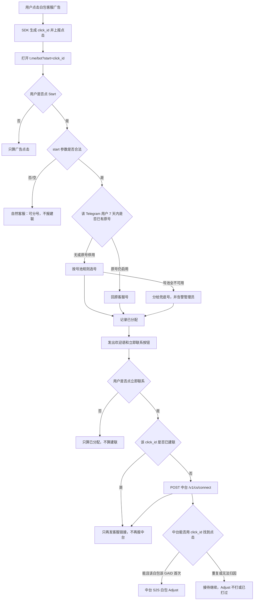

> **已并入最终需求，不要单独按本文开发。**  
> 开发以 `客服广告建联需求文档.md` V1.4 和机器人交接文档第 0 节钉死项为准。本文仅保留作历史附录。

# Telegram 客服机器人 PRD

版本：V1.0（已锁定）  
日期：2026-10-27  
基线：客服广告建联方案；现有 `web-ad` 中台、白包广告 SDK、白包 Adjust S2S  
配套：中台只做点击归因和建联回传，不负责客服号分配

---

## 1. 产品概述

这是客服建联链路里的 **Telegram 机器人**，不是广告中台，也不是白包 App。

白包里的客服广告只跳到机器人。用户点 Start 后，由 **机器人自己的号池** 分配一个客服账号，把用户交给这个号。用户确认联系后，机器人把建联报给中台；中台用 `click_id` 找回 GAID 和白包，再 S2S 到白包 Adjust。

机器人不知道 GAID，也不能自己打 Adjust。  
中台不知道有哪些客服号，也不给机器人指定分给谁。

### 1.1 一句话定位

给广告进来的用户分配客服账号的 Telegram 机器人：接住 `click_id`，按号池分号，确认联系后把建联回给中台。

### 1.2 已锁定决策

| 编号 | 决策点 | 锁定结果 |
|---|---|---|
| D1 | 广告跳转目标 | 只跳 Telegram 机器人，不跳客服私人号 |
| D2 | 谁负责分号 | 机器人。中台不做号池、不在线、不分配 |
| D3 | 分给什么 | 真实客服 Telegram 账号。用户最终去和这个号聊天 |
| D4 | 一个机器人管什么 | 一个机器人实例绑定一个号池。不同国家用不同机器人，由广告素材跳转到对应 bot |
| D5 | 什么时候分号 | 用户带着合法 `click_id` 点了 Start 之后。广告点击本身不分号 |
| D6 | 怎么分 | 熟客回原号；新客给当日已分配最少、其次当前会话最少的在班号；全离班也先分出去；满了走兜底号 |
| D7 | 建联口径 | 用户在机器人里点击「立即联系」，且机器人已发出该客服链接。同一 `click_id` 只报一次 |
| D8 | 为什么不是「给客服发了第一句」 | 用户离开机器人后，机器人看不到私人号里的对话，不能把第一句话当自动建联 |
| D9 | 中台职责 | 记录展示/点击/`click_id`；接收建联；按 `click_id` 找白包和 GAID；去重后 S2S |
| D10 | Adjust | 只用白包 App Token + 建联 Event Token。机器人不碰 Adjust |
| D11 | WhatsApp | 本次不做 |
| D12 | 客服工作台 | 本次不做。客服继续用自己的 Telegram 号接待 |

### 1.3 产品形态

- 用户侧：Telegram Bot
- 运营侧：机器人管理员命令（在 Telegram 里管号池）
- 协作侧：调用中台建联接口

不新增广告中台菜单来管客服号。

### 1.4 和现有系统的边界

| 系统 | 做 | 不做 |
|---|---|---|
| 白包 SDK | 展示/点击上报；点击时生成 `click_id`；打开 `t.me/bot?start=click_id` | 不报建联；不等中台返回再跳转 |
| 广告中台 | 下发客服素材和机器人 URL；收点击；收建联；S2S 白包 Adjust | 不管客服号名单，不分号 |
| 本机器人 | 解析 Start、号池、分号、发出客服链接、报建联 | 不读 GAID，不打 Adjust |
| 客服账号 | 用自己的 Telegram 号和用户聊天 | 不负责归因 |

---

## 2. 目标用户与使用场景

### 2.1 用户画像

| 角色 | 核心诉求 |
|---|---|
| 广告用户 | 点广告后能马上联系到能说话的客服，不要进错国家、不要重复加很多号 |
| 客服 | 新用户比较均匀进来；熟客还是找自己；号没被当日新用户打满 |
| 客服主管 / 机器人管理员 | 加减号、上下班、改上限、看谁满了、指定兜底号 |
| 中台 / 买量 | 能把这次建联认回白包买量，渠道按建联优化 |

### 2.2 典型使用场景

- 场景 1：新加坡用户点白包客服广告，SDK 打开新加坡机器人。用户 Start 后分到一个新加坡客服号，点「立即联系」进入该号。中台把这次建联打到该白包 Adjust。
- 场景 2：同一 Telegram 用户 3 天后再点广告进同一个机器人。不分新号，还是原来的客服。若这次又点了「立即联系」，机器人不再向中台重复报建联。
- 场景 3：号池里两个在班号都到了当日上限，第三个号离班。机器人把人分给离班号，用户仍能点「立即联系」；会话等客服上班再回。建联照报。
- 场景 4：用户点了广告，打开机器人但没按 Start。只算广告点击，机器人无记录，不分号，不报建联。
- 场景 5：有人转发 `t.me/bot?start=click_id`。第一个点 Start 的人占用这次 `click_id`；后来的人仍可被分号接待，但报中台时标记不能归因。
- 场景 6：用户直接搜到机器人，没有 `start` 参数。当自然客服：可分号接待，不报买量建联。

---

## 3. 核心用户动线

主链路是广告用户进机器人并确认联系。异常分支：无 `click_id`、号池不足、中台上报失败。



---

## 4. 功能清单

- 🔴 核心：接收 `/start click_id`
- 🔴 核心：客服账号与号池管理
- 🔴 核心：分配算法
- 🔴 核心：把用户交给被分配的客服账号
- 🔴 核心：建联上报中台
- 🔴 核心：粘性、占用与去重
- 🟡 重要：开口上报（Start 事件，供漏斗，不打 Adjust）
- 🟡 重要：号池不足 / 上报失败告警
- 🟡 重要：欢迎语按用户 Telegram language_code 自动切换，未覆盖用英文。开发以主需求文档 8.2.1 为准
- ⚪ 未来规划：用户不离开机器人的客服工作台
- ⚪ 未来规划：独立 Web 管理后台
- ⚪ 未来规划：WhatsApp

### 4.1 关键界面线框图

用户侧是 Telegram 对话，不是网页。最关键的一屏是 Start 之后的分配结果：

```text
+--------------------------------------+
| your_cs_bot                    Bot   |
+--------------------------------------+
| 系统：/start cK8x2mQ9pL0aB3nR7tYw4  |
|                                      |
| 机器人：                             |
| 已为你分配专属客服。                 |
| 请点击下方按钮开始咨询。             |
|                                      |
| +------------------------------+     |
| |        立即联系              |     |
| +------------------------------+     |
+--------------------------------------+

点击后：

| 机器人：                             |
| 请点击打开客服对话：                 |
| https://t.me/cs_sg_02                |
+--------------------------------------+
```

管理员侧最关键的一屏是号池列表：

```text
+--------------------------------------+
| /cs_list                             |
+--------------------------------------+
| 号池：新加坡默认                     |
| 兜底：@cs_sg_backup                  |
|                                      |
| @cs_sg_01  在班  启用  38/40  会话12 |
| @cs_sg_02  在班  启用  21/40  会话 8 |
| @cs_sg_03  离班  启用  10/40  会话 3 |
|                                      |
| 今日已分配 69  剩余名额 51           |
+--------------------------------------+
```

---

## 5. 功能详细描述

### 5.1 接收 `/start click_id`

- 功能描述：广告 SDK 打开 `https://t.me/<bot>?start=<click_id>`。用户点 Start 后，机器人解析 payload，建立本次会话。
- 触发条件：用户向本机器人发送 `/start`，或点击带 `start` 的深度链接。

#### 交互细节

- 操作反馈：收到 Start 后 2 秒内回复欢迎/分配结果，不要让用户空等。
- 危险操作确认：无。
- 空状态引导：没有 `click_id` 时回复自然客服欢迎语，不提广告、不提失败。
- 失败引导：`click_id` 格式非法时，按没有 `click_id` 处理，不要把校验细节暴露给用户。

#### 状态清单

| 状态 | 表现 | 说明 |
|---|---|---|
| 默认 | 等待用户 Start | 机器人不主动找用户 |
| 加载中 | 可先回「正在为你分配客服…」 | 选号或写库超过 1 秒时才出 |
| 成功 | 欢迎语 + 「立即联系」 | 已完成分配 |
| 失败 | 仍给出兜底号或「客服稍后接入」 | 用户侧不能是死命令 |
| 禁用 | 机器人停用 | Telegram 侧不可用，广告不应再下发该跳转 |
| 空状态 | 无 start 参数 | 自然客服流程 |

#### 边界条件

- 空内容：`/start` 无参数 → 自然客服。
- 超长：start payload 超过 64 字符或含非法字符 → 当非法，走自然客服。
- 网络异常：机器人自己的库失败 → 用兜底号，并告警。
- 无权限：普通用户不能执行管理员命令。
- 并发：同一 Telegram 用户连续多次 `/start`，以最后一次合法 `click_id` 更新本次入口，但客服号仍走粘性，不反复换号。
- 格式不符：只接受 `A-Za-z0-9_-`，长度 16～24。

#### 数据规范

| 字段名 | 类型 | 长度 | 必填 | 默认值 | 校验规则 |
|---|---|---|---|---|---|
| click_id | string | 16-24 | 广告进入时必填 | 空 | `^[A-Za-z0-9_-]{16,24}$` |
| telegram_user_id | int64 | - | 是 | Telegram 下发 | 大于 0 |
| telegram_username | string | 64 | 否 | 空 | 可空，用户可能无用户名 |
| language_code | string | 16 | 否 | 空 | 只作欢迎语参考，不分号 |
| start_time | datetime | - | 是 | 当前时间 | 机器人服务端时间 |

合法 `click_id` 由 SDK 生成，机器人不改写、不解码出 GAID。  
机器人不得要求用户手动输入 GAID、包名或广告 ID。

---

### 5.2 客服账号与号池管理

- 功能描述：每个机器人实例内维护自己的客服号名单、上限、在班状态和兜底号。运营用管理员命令维护，不在广告中台配置。
- 触发条件：Telegram 用户 ID 在管理员白名单内，发送管理命令。

#### 交互细节

- 操作反馈：命令成功后回当前号的完整状态；失败回原因，不静默。
- 危险操作确认：停用号、删除号、更换兜底号，要二次确认（再发一遍带 `confirm` 的命令，或机器人问「确认停用？是/否」）。
- 空状态引导：号池一个号都没有时，管理员执行 `/cs_list` 提示「还没有客服号，先 /cs_add」。此时普通用户 Start，走「客服稍后接入」并告警。
- 失败引导：加号时用户名无效、重复、不是管理员，明确说原因。

#### 管理员命令

| 命令 | 作用 | 示例 |
|---|---|---|
| `/cs_add @username 40 30` | 新增客服号，参数为当日新用户上限、同时接待上限 | `/cs_add @cs_sg_02 40 30` |
| `/cs_on @username` | 设为在班 | `/cs_on @cs_sg_02` |
| `/cs_off @username` | 设为离班 | `/cs_off @cs_sg_02` |
| `/cs_enable @username` | 启用 | `/cs_enable @cs_sg_02` |
| `/cs_disable @username` | 停用，需确认。已绑该号的熟客下次重分 | `/cs_disable @cs_sg_02` |
| `/cs_cap @username 40 30` | 改当日上限和同时接待上限 | `/cs_cap @cs_sg_02 50 30` |
| `/cs_fallback @username` | 设为兜底号，需确认 | `/cs_fallback @cs_sg_backup` |
| `/cs_list` | 查看号池 | `/cs_list` |
| `/cs_admins` | 查看管理员，仅超级管理员 | `/cs_admins` |

用户名统一存不含 `@` 的 Telegram username，大小写不敏感。  
一个号只能属于当前这个机器人实例，不在多个机器人之间共享计数。

#### 状态清单

| 状态 | 表现 | 说明 |
|---|---|---|
| 默认 | 新号默认启用、离班 | 加完后要手动 `/cs_on` 才进入在班池 |
| 加载中 | 无独立页面 | 命令瞬时返回 |
| 成功 | 回列表或单号状态 | 含今日已分配、剩余名额 |
| 失败 | 回错误原因 | 不改数据 |
| 禁用 | `disabled` | 不再被新分；粘性失效 |
| 空状态 | 无账号 | `/cs_list` 提示先加号 |

#### 边界条件

- 空内容：命令缺参数 → 回用法。
- 超长：username 超过 32 字符 → 拒绝。
- 网络异常：Telegram `getChat` 校验用户名失败 → 可先按字符串入库，标记「未校验」，[待补充] 是否必须校验号存在。
- 无权限：非管理员发这些命令 → 忽略或回「无权限」，不要泄露号池。
- 并发：两个管理员同时改同一号，后写覆盖前写，以数据库最后一次为准。
- 格式不符：上限不是正整数、同时接待上限小于 1 → 拒绝。

#### 数据规范

| 字段名 | 类型 | 长度 | 必填 | 默认值 | 校验规则 |
|---|---|---|---|---|---|
| cs_account | string | 32 | 是 | 无 | Telegram username，唯一 |
| daily_cap | int | - | 是 | 40 | 1～999 |
| concurrent_cap | int | - | 是 | 30 | 1～999 |
| today_assigned | int | - | 是 | 0 | 每日按配置时区零点清零 |
| open_chats | int | - | 是 | 0 | 已分配未关闭的会话数 |
| online | bool | - | 是 | false | 在班/离班 |
| enabled | bool | - | 是 | true | 启用/停用 |
| is_fallback | bool | - | 是 | false | 同一实例只能有一个兜底号 |
| last_assigned_at | datetime | - | 否 | 空 | 用于并列时挑最久没分到的 |

当日上限清零时区：[待补充]，未定前按 `Asia/Singapore`。  
默认 40/30 只是新建号时的缺省，运营可改。

---

### 5.3 分配算法

- 功能描述：Start 成功后，在本机器人号池里选出一个客服账号。中台不参与这次选择。
- 触发条件：用户 Start 进入分配；或原号被停用后需要重分。

#### 规则，按顺序执行，不得跳步

1. **粘性**  
   该 `telegram_user_id` 在 7 天内已分配过账号 A，且 A 仍启用 → 直接回 A。  
   不看 A 是否在班、是否已到上限。熟客优先于负载。
2. **过滤可分新客的号**  
   `enabled=true` 且 `today_assigned < daily_cap` 且 `open_chats < concurrent_cap`。
3. **在班优先**  
   过滤结果里如果有 `online=true` 的号，只在这些号里选。  
   如果全是离班，不要把用户挂起，改为在离班号里选，会话进该号队列。
4. **负载**  
   先比 `today_assigned` 升序，再比 `open_chats` 升序，再比 `last_assigned_at` 升序（空最前）。
5. **放宽**  
   若第 2 步无人：先放开同时接待上限，再放开当日上限，再只用兜底号。  
   每放宽一层记一条管理员告警。
6. **仍无人**  
   回复「客服正在接入，请稍等」，创建 `pending` 会话，告警管理员。用户稍后可再次 Start。

#### 交互细节

- 操作反馈：用户只看到欢迎和「立即联系」，看不到为什么分到这个号、今天排第几。
- 危险操作确认：无。
- 空状态引导：号池为空见上。
- 失败引导：pending 时允许用户再次 Start 重试。

#### 状态清单

| 状态 | 表现 | 说明 |
|---|---|---|
| 默认 | 待分配 | Start 后立刻进入算法 |
| 加载中 | 「正在为你分配客服…」 | 可选 |
| 成功 | 已绑定 cs_account | `today_assigned+1`，`open_chats+1` |
| 失败 | pending | 不计分配 |
| 禁用 | 原号停用触发重分 | 走新客规则，不沿用停用号 |
| 空状态 | 无号 | pending + 告警 |

#### 边界条件

- 空内容：号池为空 → pending。
- 超长：无。
- 网络异常：读号池失败 → 兜底号；无兜底号 → pending。
- 无权限：无。
- 并发：两个新用户同时分到同一号时，用数据库条件更新：`today_assigned < daily_cap` 才成功；失败则重跑算法，避免超发。
- 格式不符：无。

点广告、未 Start，**不得**占用任何号的 `today_assigned`。

自然客服（无合法 `click_id`）也走同一套分号，但后续不调中台建联接口。

---

### 5.4 把用户交给被分配的客服账号

- 功能描述：分配完成后，用户仍先停在机器人对话里。用户点击「立即联系」后，机器人再发出该客服号的 Telegram 链接。
- 触发条件：会话状态为已分配，且尚未发出或用户再次索取链接。

#### 交互细节

- 操作反馈：  
  1. Start 成功后发文案 + 单按钮「立即联系」。按钮类型必须是 **callback**，不能是直接 `url` 按钮，否则机器人收不到点击，无法报建联。  
  2. 用户点按钮后，先向中台报建联（见 5.5），再发客服链接 `https://t.me/<cs_account>`。  
  3. 按钮点击后改为不可重复提交的已处理态，可再给一条普通链接方便打开。
- 危险操作确认：无。
- 空状态引导：若链接发出后用户说「打不开」，识别简单关键词如「打不开 / 没反应 / link」，再发一次同样链接，不重新分号，不重复报建联。
- 失败引导：被分配号停用后，提示「正在为你更换客服」，重分后再出新按钮。

#### 状态清单

| 状态 | 表现 | 说明 |
|---|---|---|
| 默认 | 已分配，按钮未点 | 不算建联 |
| 加载中 | 按钮短暂 loading | callback 处理中 |
| 成功 | 发出 `t.me/客服号` | 建联已尝试上报 |
| 失败 | 「请稍后重试」+ 保留按钮 | 上报失败也要把链接发给用户，避免人被卡住 |
| 禁用 | 原号停用 | 重分 |
| 空状态 | 无 | 无 |

#### 边界条件

- 空内容：客服 username 丢失 → 重分或兜底。
- 超长：无。
- 网络异常：中台上报失败 → **仍然发客服链接**，本地记 `report_failed`，后台重试上报。人比归因优先。
- 无权限：无。
- 并发：同一用户连点按钮，只处理第一次，后续只补发链接。
- 格式不符：客服账号必须能拼出 `https://t.me/{username}`。

预填进客服对话框的文本：[待补充]。未定前不预填 `click_id`，避免用户看到一串追踪码。若后续要给客服看来源，另做客服侧备注，不要写在用户可见输入框里。

---

### 5.5 建联上报中台

- 功能描述：用户点击「立即联系」后，机器人调用中台 `POST /v1/cs/connect`。中台负责找回点击、去重、S2S。机器人只保证「有合法 click_id 的确认联系只报一次」。
- 触发条件：callback「立即联系」；该会话有合法 `click_id`；该 `click_id` 本地尚未标记 `connected`。

无合法 `click_id` 的自然客服 **禁止** 调用该接口。

#### 交互细节

- 操作反馈：上报是后台动作，用户只看到客服链接。不要对用户说「已上报 / 归因成功」。
- 危险操作确认：无。
- 空状态引导：无。
- 失败引导：失败不打扰用户；管理员告警；本地重试。

#### 状态清单

| 状态 | 表现 | 说明 |
|---|---|---|
| 默认 | 未上报 | 已分配未点按钮 |
| 加载中 | 正在 POST | 用户已点按钮 |
| 成功 | `connected` + 中台返回成功 | 中台是否归因由返回值说明 |
| 失败 | `report_failed` | 发链接不受影响 |
| 禁用 | 无 click_id | 不上报 |
| 空状态 | 无 | 无 |

#### 边界条件

- 空内容：缺 click_id → 不上报。
- 超长：字段超长截断或拒绝，见下表。
- 网络异常：超时 3 秒视为失败，最多再试 3 次，间隔 5s / 30s / 5min。三次后停，等人工或下次进程补偿。
- 无权限：签名错误会被中台拒绝，必须告警，说明密钥错了，不要对用户暴露。
- 并发：以 `click_id` 本地唯一键保证只成功发出一次业务请求；重试用同一请求幂等。
- 格式不符：中台返回 4xx，除 409 已建联外，不要盲重试改字段。

#### 请求规范

`POST {中台域名}/v1/cs/connect`

Header：

| 字段名 | 类型 | 长度 | 必填 | 默认值 | 校验规则 |
|---|---|---|---|---|---|
| X-Cs-Timestamp | string | 16 | 是 | 当前 unix 秒 | 与中台时间差不超过 300 秒 |
| X-Cs-Sign | string | 64 | 是 | HMAC-SHA256 | `hex(hmac_sha256(secret, timestamp + "." + body))` |
| Content-Type | string | - | 是 | application/json | JSON |

Body：

| 字段名 | 类型 | 长度 | 必填 | 默认值 | 校验规则 |
|---|---|---|---|---|---|
| click_id | string | 16-24 | 是 | 无 | 与 Start 收到的一致 |
| telegram_user_id | string | 32 | 是 | 无 | 数字字符串 |
| telegram_username | string | 64 | 否 | 空 | 可空 |
| cs_account | string | 32 | 是 | 无 | 不含 `@` |
| connect_time | int | - | 是 | 按钮点击时间 | unix 秒 |
| event | string | 16 | 是 | connect | 固定 `connect` |

禁止上传：GAID、广告 ID、白包 app_id、聊天内容、手机号。  
机器人没有这些值，也不准向用户索取后转发。

中台返回：

| 字段名 | 含义 |
|---|---|
| code=200 且 attributed=true | 已对上点击，中台按自身规则决定是否 S2S |
| code=200 且 attributed=false | 点击对不上或过期，当自然建联，机器人仍接待 |
| code=200 且 duplicate=true | 该 click_id 或该白包该 GAID 已经建联，不再 S2S |
| 409 | 与 duplicate 同等处理 |
| 5xx / 超时 | 机器人重试 |

中台域名、签名密钥：[待补充]。  
密钥只放机器人服务端和中台，不进 BotFather 简介，不进客户端。

#### 中台侧必须同时具备的能力

本机器人能工作的前提，不在机器人代码里实现，但必须同期交付：

1. SDK 点击上报带 `click_id`，并立刻打开 `t.me/<bot>?start=<click_id>`。
2. 中台 `ad_log` 能按 `click_id` 找到 `gaid、app_id、ad_id`。
3. 中台建联去重：同一 `click_id` 一次；同一白包 + 同一 GAID 只 S2S 一次。
4. 白包配置建联 Event Token。
5. 点击日志晚于机器人回调时，中台先收 pending，点击到达后再补归因。pending 保留 48 小时。

---

### 5.6 粘性、占用与去重

- 功能描述：防止同一人被反复换号，防止同一广告点击被多个 Telegram 用户占用，防止 Adjust 被打多次。
- 触发条件：每次 Start、每次「立即联系」。

#### 规则

| 规则 | 处理 |
|---|---|
| 同一 telegram_user_id，7 天内 | 回原客服号 |
| 同一 click_id，第一个 Start 的 telegram_user_id | 占用该 click_id |
| 同一 click_id，其他 Telegram 用户再 Start | 可分号接待，标记 `attributed=false`，点「立即联系」也不调中台，或调了也由中台拒绝归因 |
| 同一 click_id 多次「立即联系」 | 只第一次报中台 |
| click_id 超过 7 天 | 当过期。可接待，不报买量建联 |
| 原客服号被停用 | 粘性取消，按新客重分 |

#### 交互细节

- 操作反馈：用户无感知。
- 危险操作确认：无。
- 空状态引导：无。
- 失败引导：无。

#### 状态清单

| 状态 | 表现 | 说明 |
|---|---|---|
| 默认 | 新会话 | 无粘性 |
| 加载中 | 无 | 无 |
| 成功 | 绑定 user↔号、click_id↔user | 写本地表 |
| 失败 | 写库失败则退兜底 | 告警 |
| 禁用 | 号停用 | 清粘性 |
| 空状态 | 无历史 | 走新客 |

#### 边界条件

- 空内容：无历史 → 新客。
- 超长：无。
- 网络异常：粘性表读失败 → 当新客分号，可能换号，需告警。
- 无权限：无。
- 并发：`click_id` 占用用唯一索引，第二个写入失败即视为被占用。
- 格式不符：无。

#### 数据规范

| 字段名 | 类型 | 长度 | 必填 | 默认值 | 校验规则 |
|---|---|---|---|---|---|
| telegram_user_id | int64 | - | 是 | 无 | 粘性主键 |
| cs_account | string | 32 | 是 | 无 | 当前绑定号 |
| click_id | string | 24 | 否 | 空 | 有则唯一占用 |
| assigned_at | datetime | - | 是 | 当前时间 | 粘性从该时间起算 7 天 |
| connected_at | datetime | - | 否 | 空 | 第一次点「立即联系」 |
| attributed | bool | - | 是 | false | 仅合法 click_id 且本用户是占用者时为 true |
| report_status | string | 16 | 是 | none | none / pending / success / failed |

---

### 5.7 开口上报

- 功能描述：用户 Start 成功后，机器人可向中台报 `event=start`，只给漏斗看「点了广告但没进机器人 / 进了但没点立即联系」。不触发 Adjust。
- 触发条件：合法 `click_id` 的 Start 成功分配后。自然客服不上报。

本项为 🟡。第一期若中台接口未就绪，可只写机器人本地日志，不阻塞分号。

#### 数据规范

与建联接口相同路径或 `POST /v1/cs/start`，body 的 `event` 为 `start`，无 `connect_time`，改为 `start_time`。[待补充] 中台是否拆两个 URL。

---

### 5.8 告警

- 功能描述：号池和上报异常打到管理员 Telegram，不打到用户。
- 触发条件：号池放宽规则、无号可分、建联连续失败、签名被拒、当日剩余名额低于 20%。

文案给管理员，例如：「新加坡号池剩余名额 8，请加号或提高上限。」

---

## 6. 文案规范

### 6.1 产品整体文案风格

简洁直接。用户侧像人工客服入口，不提 SDK、中台、Adjust、click_id。管理员侧短命令、短状态。

### 6.2 面向终端用户

语言按用户 Telegram language_code 自动切换，不按实例国家写死。[待补充] 各语言终稿。未定前用以下中文/英文底稿，未覆盖语言用英文。开发以主需求文档为准。

- 按钮：立即联系
- 加载中：正在为你分配客服…
- 成功分配：已为你分配专属客服。请点击下方按钮开始咨询。
- 发出链接：请点击打开客服对话：
- 无 start 参数：你好，请直接点击下方按钮联系客服。
- 号池为空：客服正在接入，请稍后再试。
- 链接打不开（用户再问）：请再次点击打开客服：
- 更换客服：原客服暂不可用，正在为你更换。
- 错误提示：不要对用户说「上报失败」「归因失败」「click_id 无效」。
- 危险操作确认：仅管理员，例如「确认停用 @cs_sg_02？回复 /cs_disable @cs_sg_02 confirm」

### 6.3 面向管理员

- 成功：已启用 @cs_sg_02，在班，上限 40/30，今日 0，会话 0
- 空状态：还没有客服号，先 /cs_add @username 40 30
- 无权限：无权限
- 告警：号池剩余名额不足 / 建联上报连续失败

---

## 7. 非功能性需求

- 性能：Start 到分配结果 ≤ 2 秒（不含用户点 Start 的时间）。建联上报异步，不阻塞发客服链接。
- 权限：管理员白名单。普通用户只有 Start、点按钮、发文本。管理命令不在 BotFather 的用户可见 command 列表里展示细节也可，但代码必须校验白名单。
- 兼容性：Telegram Bot API 官方接口；用户端覆盖官方 Telegram Android。其他客户端能打开 `t.me` 即可。本次不做 iOS 白包 SDK。
- 数据安全：签名密钥、Bot Token 只放服务端。日志可留 `click_id`、username，聊天正文默认不落库。[待补充] 是否因风控要存首条消息。
- 数据存储：机器人独立库，至少有客服号表、粘性表、会话表。不写广告中台的号池表。
- 可靠性：Webhook 收消息；服务重启后会话状态以数据库为准。Telegram 重复推送同一 update，按 `update_id` 幂等。
- 多实例：一个国家一个机器人，各用自己的 Bot Token 和号池。配置不要写死成单例全局号池。
- 时区：当日上限按实例配置时区清零，未定前 `Asia/Singapore`。

---

## 8. 范围与非目标

本次做：

- 创建可多实例部署的 Telegram 客服机器人
- Start 解析 `click_id`
- 号池与管理员命令
- 粘性、在班优先、上限、最少分配、兜底
- 「立即联系」后发客服号链接
- 建联上报中台，失败重试
- 管理员告警

本次不做：

- 不在广告中台里做客服号分配
- 不让机器人打 Adjust
- 不做用户始终留在机器人里的坐席工作台
- 不做 WhatsApp
- 不做独立 Web 管理后台
- 不把 GAID 放进 start 参数
- 不在用户可见预填文本里暴露追踪码

能力上限（必须写进验收说明）：

机器人能确认「用户愿意打开被分配的客服号」。  
机器人不能确认「用户已经给该客服发出第一句话」或「客服已经回复」。

---

## 9. 验收标准

在测试机器人、测试中台、测试白包上验收。

| 编号 | 场景 | 期望结果 |
|---|---|---|
| B1 | SDK 打开 `t.me/bot?start=合法click_id`，用户点 Start | 2 秒内收到分配结果和「立即联系」 |
| B2 | 用户点「立即联系」 | 收到 `t.me/被分配号`；中台收到一条 connect；白包 Adjust 在配置齐全时出现一次建联 |
| B3 | 同一 click_id 再点「立即联系」 | 可再发链接；中台不再新增建联；Adjust 不重复 |
| B4 | 同一 Telegram 用户 7 天内再次 Start | 仍是原客服号 |
| B5 | 原客服号被 `/cs_disable` | 再次 Start 分到其他启用号 |
| B6 | 两个在班号上限不同、已分配不同 | 新客分给已分配更少的那个 |
| B7 | 在班号全满、存在离班号 | 分给离班号，管理员收到告警 |
| B8 | 无 start 参数 | 可分号；不调中台 connect |
| B9 | 非法 start 参数 | 同 B8 |
| B10 | 第二个 Telegram 用户使用已被占用的 click_id | 可接待；不归因到这次买量 |
| B11 | 中台 5xx | 用户仍能收到客服链接；机器人重试上报；管理员可看到失败 |
| B12 | 非管理员发 `/cs_list` | 看不到号池 |
| B13 | `/cs_add` 后 `/cs_on` | `/cs_list` 能看到该号在班 |
| B14 | 广告点击但用户未 Start | 该号 `today_assigned` 不增加 |
| B15 | 点击日志晚于 connect 回调 | 中台 pending，日志到达后补归因；机器人侧仍显示成功发链 |

---

## 10. 实现分工

| 工作 | 负责人 | 产出 |
|---|---|---|
| BotFather 建机器人、拿到 Token | 运营 / 技术 | 每国家一个 bot username + Token |
| 机器人服务：Start、号池、分号、按钮、上报 | 机器人开发 | 可部署的 bot 服务 |
| 管理员白名单和命令 | 机器人开发 | 能加减号、上下班、改上限 |
| 中台 `/v1/cs/connect` 与 pending 补齐 | 中台开发 | 按 click_id 归因并 S2S |
| SDK 生成 click_id 并拼到 start | SDK 开发 | 客服广告点击打开带参机器人链接 |
| 白包建联 Event Token | Adjust 操作 + 中台运营 | 白包能填建联事件 Key |
| 素材跳转改为对应国家机器人 URL | 中台运营 | 不再填私人客服号 |
| 测试验收 | 测试 | 跑完第 9 节 |

---

## 11. 待确认问题

以下不阻塞按本文开发，但上线前要补：

1. 各机器人实例的语言和欢迎语终稿。
2. 当日上限清零时区是否按国家改，还是统一。
3. 中台域名、签名密钥、`/v1/cs/connect` 与 `/v1/cs/start` 是否拆分。
4. 加号时是否必须校验该 Telegram 用户名真实存在。
5. 是否给客服侧另推一条「新用户来了」通知。未定前不做。
6. 会话何时从 `open_chats` 减 1。未定前只在管理员 `/cs_close @username <tg_user_id>` 或粘性过期时减。建议补一个关闭命令。
7. 老版本 SDK 不会拼 `start` 时，该白包是否停发客服素材。

---

## 附录：老板确认记录

确认日期：2026-10-27

1. 客服建联广告跳转 Telegram 机器人。  
2. 由机器人分配客服账号，不在中台分号。  
3. 建联后由机器人报中台，中台 S2S 到白包 Adjust。  
4. 多客服账号按号池分配：粘性、在班优先、当日上限、最少接待、兜底。  
5. 一个国家一个机器人实例，素材跳对应 bot。  
6. 本次不做 WhatsApp，不做机器人内坐席工作台。
