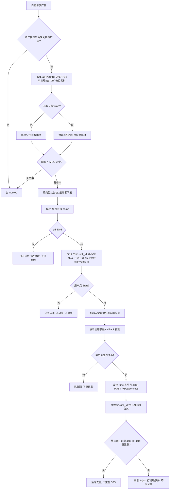
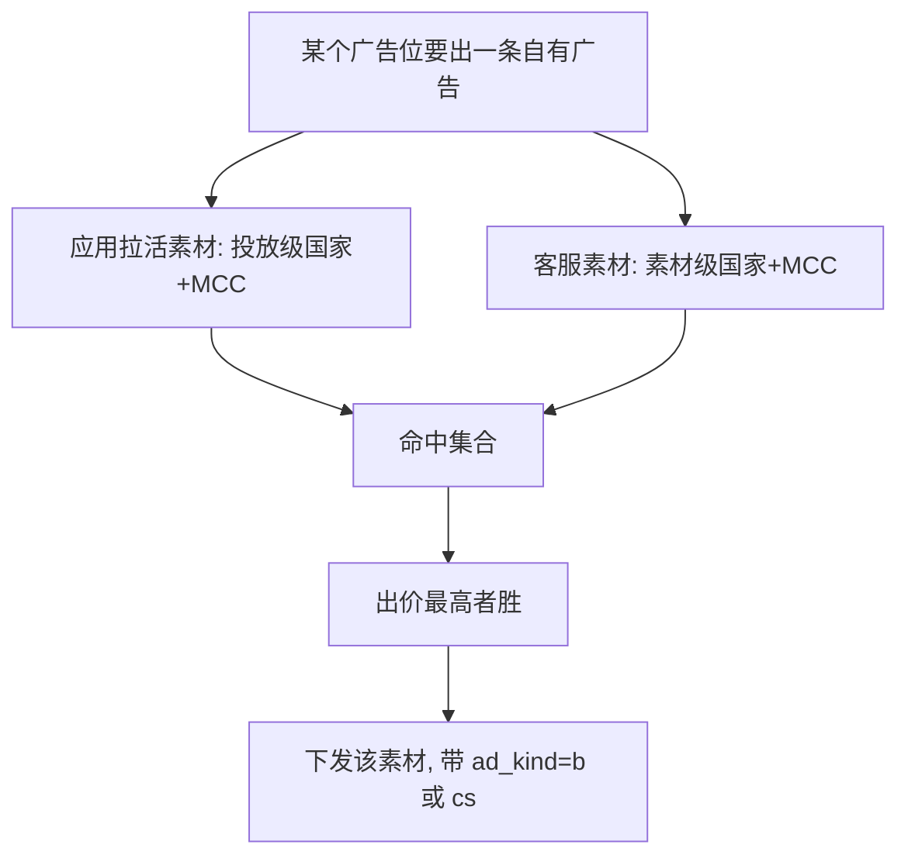

# 客服广告建联需求文档

版本：V1.4（本次更新：钉死占用 click_id、HTTP 200、粘性计数、B7 告警、库失败、超级管理员配置）  
日期：2026-10-27  
交付对象：中台 / SDK / Telegram 机器人 / Adjust 配置 / 测试  
后台原型：本目录 `index.html`（v9）  
历史对照：`../2026-10-26-客服广告建联` 只作旧页面参考，不得按旧口径开发

【最终口径，与旧稿/旧原型冲突时以本文为准】

1. **建联** = 用户在 Telegram 机器人点击「立即联系」，且机器人已发出该客服链接。不是点广告，不是打开 Telegram，也不是给客服发了第一句。
2. 客服素材跳转只允许国家机器人 `https://t.me/<bot>`，不能带 `?start=`，不能填私人号或 WhatsApp。
3. **白包不再选自有广告类型。** 一个白包可以同时关联多条「应用拉活」和「客服建联」投放。各广告位独立按 N 插入自有广告；该次自有广告从所有已关联、已启用投放的命中素材里选出价最高者。
4. 客服号分配只在 Telegram 机器人里做。中台不管号池。
5. SDK 生成 `click_id` 并打开 `t.me/bot?start=click_id`。SDK 不报建联。机器人报中台，中台 S2S 白包 Adjust 建联事件。
6. **B 包子账户**挂在账户上，不挂在角色上。角色继续管菜单和操作；账户指定一个或多个投放后，只能看这些投放及其关联数据。

---

## 1. 产品概述

白包广告位默认走 AdMob。开屏、Banner、激励各自按 N 插入自有广告。自有广告来自白包已关联的投放，投放类型可以是 **B 包应用拉活** 或 **客服建联**，二者可以同时存在于同一个白包。

客服建联的目标：把买量进来的人导到 Telegram 客服成交，并把「确认联系」回传到 **白包 Adjust**，给 Facebook / Google 优化。应用拉活的目标不变：把人导到 B 包，把安装/付费回传白包 Adjust。

同一白包里，这两种转化可以同时发生。例如：首页/开屏出 B 包应用拉活广告，其他广告位出客服建联广告。

整条客服链拆成四段，不要混：

| 段 | 谁做 | 结果 |
|---|---|---|
| 出广告 | 中台按国家+MCC+出价，在该白包所有关联投放里选素材；SDK 按 N 展示 | 展示 |
| 点广告 | SDK 生成 `click_id`，报中台，打开机器人 | 点击 |
| 分客服 | Telegram 机器人按自己的号池分配真实客服号 | 已分配，还不算建联 |
| 建联回传 | 用户在机器人点「立即联系」→ 机器人报中台 → 中台 S2S 白包 Adjust | 建联 |

### 1.1 一句话定位

给白包买量用的客服导流方案：广告跳到对应国家的 Telegram 机器人，机器人分客服号，确认联系后认回白包 Adjust。同一白包仍可同时投放应用拉活。

### 1.2 已锁定决策

| 编号 | 决策点 | 锁定结果 |
|---|---|---|
| D1 | 白包自有广告类型 | **取消。** 白包不再选「B包广告 / 客服建联」。该字段现网若存在则废弃，下发不再读取 |
| D2 | 一个白包能挂多少投放 | 可同时关联多条应用拉活 **和** 多条客服建联。不再互斥 |
| D3 | 广告位 | 不新增独立客服广告位。只混在开屏 / Banner / 激励 |
| D4 | 插入规则 | 默认 AdMob；按 N 插自有广告。三个广告位分开计、分开选素材 |
| D5 | 该次自有广告怎么选 | 该白包所有已关联、已启用投放里，广告位匹配且国家+MCC 命中的素材一起比出价，最高者下发；都未命中则 AdMob |
| D6 | 客服投放放哪 | 仍放在「B包管理」，投放类型选客服建联。不新开顶级菜单 |
| D7 | 定向 | 客服：国家、MCC 配在每条素材上，国家且 MCC 都命中才出。应用拉活：国家、MCC 仍配在投放上 |
| D8 | 广告跳转 | 客服素材只填 Telegram 机器人 `https://t.me/<bot>`，不填私人客服号、不填 wa.me、不带 start |
| D9 | 谁分客服号 | **机器人。** 中台不管号池、不在线、不分配 |
| D10 | 分给什么 | 真实客服 Telegram 账号。用户最终去和这个号聊天 |
| D11 | 机器人怎么拆 | 一个国家一个机器人实例，各有自己的号池。素材跳到对应 bot |
| D12 | 什么时候分号 | 用户带着合法 `click_id` 点了 Start 之后。广告点击不分号 |
| D13 | 怎么分 | 熟客 7 天回原号；新客给当日已分配最少、其次当前会话最少的在班号；全离班也先分；满了走兜底号 |
| D14 | 建联口径 | 用户在机器人点击「立即联系」，且机器人已发出该客服链接 |
| D15 | 中台职责 | 下发素材、记展示/点击/`click_id`、收 start/connect、按 `click_id` 找白包和 GAID、去重后 S2S |
| D16 | Adjust | 白包同时保留注册/付费/首充/B包安装/**建联** Event Token。哪种转化发生打哪种。机器人不碰 Adjust。建联不传金额 |
| D17 | WhatsApp | 本次不做 |
| D18 | 客服工作台 | 本次不做。客服用自己的 Telegram 号接待 |
| D19 | 中台后台管号 | 不做。加减号、上下班、改上限都在机器人管理员命令里 |
| D20 | 老 SDK | 不会拼 `start` 的版本：该次请求排除全部客服素材，应用拉活照常可出。不要因此停掉整个白包 |
| D21 | B 包子账户 | **新增。** 沿用现网角色权限，在账户上增加数据范围。指定投放后只能看对应投放及相关白包/素材/设备/看板数据。超级管理员必须看全部 |
| D22 | 机器人语言 | **按用户环境语言自动切换。** 以 Telegram `language_code` 为准，不按机器人实例国家写死。匹配不到用英文 |

### 1.3 各端边界

| 系统 | 做 | 不做 |
|---|---|---|
| 中台后台 | 白包 N 和全套 Adjust Key、客服投放、素材（图/国家/MCC/机器人 URL）、报表、账户角色、B 包子账户数据范围 | 不管客服号名单；白包不再选自有广告类型；不按白包隔离账号 |
| 白包 SDK | 按 N 展示；报 show/click；点击生成 `click_id`；客服广告打开 `t.me/bot?start=click_id` | 不报建联；不等中台返回再跳 |
| 中台服务 | 定向下发、跨类型比价、点击入库、`/v1/cs/start`、`/v1/cs/connect`、pending 补齐、S2S | 不分号 |
| Telegram 机器人 | 解析 Start、号池、分号、发客服链接、报建联 | 不读 GAID，不打 Adjust |
| 客服账号 | 用自己的号和用户聊天 | 不负责归因 |
| Adjust / 买量 | 白包建联事件、映射给渠道 | 不接收 Telegram 账号和聊天内容 |

### 1.4 原待确认项（本次一并锁定）

| 原问题 | 锁定结果 |
|---|---|
| start / connect 是否两个 URL | **两个。** `POST /v1/cs/start` 只记漏斗，不 S2S；`POST /v1/cs/connect` 才建联并 S2S |
| 当日上限清零时区 | 按机器人实例配置，默认 `Asia/Singapore`。不同国家实例可配不同时区 |
| 欢迎语终稿 | **【本次更新】** 用户侧文案按 Telegram `language_code` 自动切换。开发先用 8.2 底稿。终稿由运营替换，不阻塞开发。未覆盖语言用英文 |
| 加号是否校验用户名真实存在 | 尽量调用 Telegram `getChat` 校验；失败允许入库并标记「未校验」，不阻塞加号 |
| 是否给客服推「新用户来了」 | **V1 不做** |
| 会话何时从 `open_chats` 减 1 | 管理员 `/cs_close @username <tg_user_id>`，或粘性 7 天到期 |
| 中台域名、HMAC secret | 部署配置，不写进产品文案。密钥只放服务端 |
| SDK 版本如何拦截老包 | SDK 初始化继续带版本号。中台对不支持 `start` 的版本排除客服素材，应用拉活不受影响 |
| 测试设备打不打 Adjust | 建联照常落库。**默认不打生产 Adjust。** 是否打测试环境由部署开关 `adjust_s2s_for_test_device` 控制，默认 `false` |
| 跳转 URL 要不要格式校验 | **要。** 客服素材必须 `^https://t.me/[A-Za-z0-9_]{5,32}$` |
| 给客服对话框预填来源 | **V1 不预填。** 不要把 `click_id` 暴露给用户 |

上线前仍需运营/运维提供、但不阻塞按本文开发的，只剩第 15 节三项。

---

## 2. 目标用户与场景

| 角色 | 做什么 |
|---|---|
| 中台运营 | 配白包 N 和全套 Adjust Key；在 B 包管理建应用拉活/客服投放并关联白包；客服素材填对应国家机器人 |
| 超级管理员 | 管全部投放和数据；给指定投放配置子账户 |
| B 包子账户 | 只看被授权的投放（应用拉活/客服建联）以及这些投放带出来的白包、素材、设备、看板数据 |
| 机器人管理员 | 在对应国家机器人里加号、上下班、改上限、设兜底号 |
| 客服 | 用被分配到的 Telegram 号接待 |
| 广告用户 | 点客服广告 → Start 机器人 → 点立即联系 → 和客服号聊天 |
| 买量运营 | 在白包 Adjust / 渠道里按建联和/或付费优化 |

典型场景：

1. **混合投放。** A2test 同时关联 B2（应用拉活）和「客服-东南亚」。开屏命中后 B2 出价更高，出 B2；Banner 命中后客服素材出价更高，出客服广告。用户在同一白包里既可能去 B 包付费，也可能去 Telegram 建联。
2. **新加坡建联。** 新加坡用户点到客服开屏，SDK 打开 `https://t.me/sg_cs_bot?start=<click_id>`。用户 Start 后分到 `@cs_sg_02`，点「立即联系」。中台把这次建联打到 A2test 的 Adjust。
3. **熟客。** 同一 Telegram 用户 3 天后再进同一个机器人，不分新号，还是原来的客服。再点「立即联系」不重复报中台、不重复打 Adjust。
4. **号池不足。** 在班号全满，存在离班号：分给离班号，用户仍能建联，管理员收到告警。
5. **自然进线。** 用户直接搜到机器人、没有 start：可分号接待，不报买量建联。
6. **老 SDK。** 某白包已配客服投放，但设备上的 SDK 不会拼 start：这次请求只出应用拉活或 AdMob，不出客服素材。
7. **B 包子账户。** 超管给 `com.demo2b.app.b2` 建子账户 `b2ops`。该账户登录后只能看到 B2 投放、B2 素材、B2 广告数据，以及关联了 B2 的白包；看不到 B1 和「客服-东南亚」。看板数字只汇总 B2。

---

## 3. 端到端主流程

主链路是客服建联。异常分支：老 SDK、未命中、无 start、号池不足、connect 早于 click。



广告位选择：



---

## 4. 功能清单

- 🔴 白包：去掉自有广告类型；保留三个 N；保留全套 Adjust Key（含建联）
- 🔴 B 包管理：投放类型应用拉活 / 客服建联；可同时关联同一白包
- 🔴 客服素材：图、广告位、出价、国家、MCC、`t.me` 机器人 URL
- 🔴 下发：跨投放、跨类型、按广告位比价；老 SDK 排除客服素材
- 🔴 SDK：`click_id` + `t.me/bot?start=click_id`
- 🔴 机器人：Start、号池、分号、「立即联系」、报中台；用户语文案按环境语言自动切换
- 🔴 中台：click 入库、start 漏斗、connect 归因、pending 48h、去重、S2S
- 🟡 报表：展示/点击合计；付费只算应用拉活；建联只算客服「立即联系」
- 🟡 测试设备：跳过定向和频次；建联落库；默认不打生产 Adjust
- 🔴 账户权限：沿用现网角色（菜单+操作）；账户增加 B 包/投放数据范围，子账户只能看授权投放的相关数据
- ⚪ 不做：WhatsApp、独立客服广告位、中台号池、机器人内坐席工作台、给客服推新用户通知、按白包隔离账号

### 4.1 白包编辑页对照

```text
+--------------------------------------------------+
| 编辑白包APP                                      |
+--------------------------------------------------+
| APP名称 [A2test]     包名 [com.a22.ad.test.a]    |
| 开屏N [3]  BannerN [1]  激励N [0]                |
| AdjustToken [______]  注册Key [______]           |
| 付费Key [______]  首充Key [______]               |
| B包安装Key [______]  建联事件Key [______]        |
| 说明：不再选自有广告类型。关联哪些投放在 B包管理 |
+--------------------------------------------------+
```

---

## 5. 中台后台

不新开顶级菜单。**【本次更新】** 权限分两层，都沿用现网账户/角色页，不新开菜单：

1. **功能权限**：继续用现网角色。白包配置走白包权限，客服素材走物料权限，B 包/投放走 B 包权限。
2. **数据范围**：挂在账户上，不挂在角色上。给账户指定一个或多个投放后，该账户只能看这些投放及其关联数据。

### 5.1 白包 APP 🔴

相对现网：

| 项 | 处理 |
|---|---|
| 自有广告类型 | **删除。** 表单不再展示。服务端不再用该字段过滤投放。历史值可留库但忽略 |
| 开屏 N / Banner N / 激励 N | 保留，含义不变 |
| AdjustToken | 保留 |
| 注册 / 付费 / 首充 / B包安装事件Key | 保留，始终可填 |
| 建联事件Key | **新增**，始终可填，不要跟类型走 |
| 客服素材按钮 | 白包上没有。素材只在 B 包管理 |

保存时不要再做「类型不一致」拦截。同一白包被应用拉活和客服建联同时勾选是合法的。

N 的含义不变，三个广告位独立计数：

| N | 含义 |
|---|---|
| 0 | 该位一直 AdMob |
| 1 | 该位一直自有广告 |
| 5 | 每 5 次展示插 1 次自有 |

「自有广告」不再等于某一种投放类型，只表示「这次不出 AdMob，而出关联投放里选中的那条素材」。

### 5.2 B 包管理 🔴

投放类型：

| 类型 | 必填 | 定向放哪 |
|---|---|---|
| 应用拉活 | 包名、商店、国家、MCC、关联白包 | 投放上 |
| 客服建联 | 投放名称、关联白包 | 国家和 MCC 在素材上。不强制包名和商店 |

一个投放可关联多个白包。一个白包可被多个投放关联，类型可以混。

投放状态：

| 状态 | 含义 |
|---|---|
| 投放中 | 投放启用，且至少关联一个启用中的白包 |
| 部分投放 | 关联了多个白包，其中部分禁用 |
| 未投放 | 未关联白包，或关联的白包全部禁用 |
| 已停用 | 投放本身停用。数据保留，不再下发 |

停用投放：停止出该投放的广告，历史数据和关联保留。没有「切换白包类型」这个动作。

### 5.3 客服素材 🔴

| 字段 | 必填 | 规则 |
|---|---|---|
| 广告类型 | 是 | 开屏 / Banner / 激励 |
| 素材图 | 是 | 沿用现网上传 |
| 出价 | 是 | ≥ 0 |
| 跳转 URL | 是 | 必须 `^https://t.me/[A-Za-z0-9_]{5,32}$`。保存时校验。拒绝 `?start=`、`wa.me`、私人号 |
| 国家 | 是 | 可多选，不允许空 |
| MCC | 是 | 可多选，不允许空 |
| 状态 | 是 | 启用 / 停用 |

一条素材可以覆盖多个国家，但这些国家必须共用同一个机器人。新加坡和越南如果是两个 bot，就要拆成两条素材。  
不要把私人客服号写进跳转。分号不在素材里完成。

保存失败留在表单并提示。成功提示并刷新列表。

### 5.4 出广告规则 🔴

当某广告位按 N 轮到自有广告时，按下面顺序选 **一条** 素材。应用拉活和客服建联走同一套竞争，不要先按类型过滤。

1. 取出该白包所有 **启用中** 的关联投放（两种类型都要）。
2. 取出这些投放里，广告位匹配且启用中的素材。
3. 若该次请求的 SDK **不支持** 给 Telegram 链接拼 `start`：排除全部客服素材，应用拉活留下。
4. 定向过滤：
   - 客服素材：设备 IP 国家在素材国家列表，且 MCC 在素材 MCC 列表。
   - 应用拉活素材：设备 IP 国家在投放国家列表，且 MCC 在投放 MCC 列表。
5. 剩余集合为空 → 本次该位出 AdMob。
6. 否则选出价最高者；同价保留先配置的（创建时间更早，或现网等价稳定次序）。
7. 下发时带 `ad_kind=cs` 或 `ad_kind=b`，`jump_url` 仍是静态地址，初始化时不要写入 `click_id`。

测试设备：跳过定向和频次，直接在该位所有已关联启用素材里选出价最高者。老 SDK 测试设备同样排除客服素材。

不要再实现「白包类型与投放类型不一致 → 未投放」。这条作废。

### 5.5 报表

| 指标 | 口径 |
|---|---|
| 展示 | SDK `event=show` 的自有广告（应用拉活 + 客服） |
| 点击 | SDK `event=click` 的自有广告（应用拉活 + 客服） |
| 建联 | 中台 `cs_connect_log` 归因成功的记录。**不是点击，不是打开 Telegram** |
| 开口 | 可选。`/v1/cs/start` 成功。不算建联，不打 Adjust |
| 付费 | 只统计应用拉活 |
| 安装 | 只统计应用拉活的 B 包安装 |

看板：展示/点击 = 全部自有广告合计；付费只算应用拉活；建联只算客服建联。  
白包列表同时展示付费和建联，因为同一白包两种都可能发生。  
客服投放的广告数据弹窗：只留展示、点击、建联。  
应用拉活投放的广告数据弹窗：安装、日活、展示、点击、付费。

漏斗建议在客服投放详情能看到：展示 → 点击 → 开口（如有）→ 建联。

### 5.6 账户与 B 包数据范围 🔴 【本次更新】

对照现网 [AdControl 账户/角色](https://adbridgehub.com/web-ad/account)：

| 现网能力 | 本次处理 |
|---|---|
| 账户：用户名、密码、姓名、角色、增删改密 | **保留** |
| 角色：按模块勾选菜单和操作 | **保留。** 数据概览、白包APP、B包管理、广告物料、设备管理、账户管理、角色管理 |
| 按投放/B 包隔离数据 | **新增。** 现网没有，所有账号目前都能看到全部投放 |

不要把数据范围做成新角色类型，也不要按白包隔离。隔离主键是 **B 包管理里的投放**，包含应用拉活和客服建联。

#### 两层权限

| 层 | 配在哪 | 管什么 | 例子 |
|---|---|---|---|
| 功能权限 | 角色 | 能进哪些菜单、能不能新增/编辑/删除 | 运营可看 B 包列表和广告数据，不能管账户 |
| 数据范围 | 账户 | 能看哪些投放的数据 | `b2ops` 只授权 `com.demo2b.app.b2` |

生效方式：功能权限 **且** 数据范围，两层都过才展示。有 B 包查看权限但没授权该投放 → 看不到。授权了投放但角色没勾 B 包菜单 → 进不去 B 包管理。

#### 账户上的数据范围字段

在现网「新增/编辑管理员」里，角色下面增加：

```text
+--------------------------------------------------+
| 新增/编辑管理员                                  |
| 用户名 [b2ops]   密码 [******]                   |
| 姓名   [B2运营]  角色 [运营]                     |
| 数据范围                                         |
|   ( ) 全部投放     可看所有应用拉活和客服建联     |
|   (•) 指定投放     必选至少 1 个投放              |
|       [x] com.demo2b.app.b2   应用拉活            |
|       [ ] com.demo2b.app.b1   应用拉活            |
|       [ ] 客服-东南亚         客服建联            |
+--------------------------------------------------+
```

| 字段 | 规则 |
|---|---|
| 全部投放 | 与现网超管行为一致，能看全部投放和全部白包 |
| 指定投放 | 多选 B 包管理中的投放，应用拉活和客服建联都可以勾。至少 1 个 |
| 超级管理员 | 必须「全部投放」，表单禁用指定。不能把超管改成子账户 |
| 未指定 | 非超管保存时，数据范围必填。禁止保存成「指定投放但一个都没勾」 |
| 谁能配 | 仅有账户编辑权限的人可改别人的数据范围。子账户不能给自己扩权 |

账户列表增加「数据范围」列：全部投放 / 投放名称列表。

#### 指定投放后能看什么

以授权 `com.demo2b.app.b2` 为例。B2 当前关联白包 A2test。

| 页面 | 子账户看到 | 看不到 |
|---|---|---|
| 数据概览 | 只汇总授权投放及其关联白包 | 其他投放的安装/展示/点击/付费/建联 |
| 白包 APP | 只列出至少关联了一个授权投放的白包；列表和详情指标只统计授权投放 | 未关联授权投放的白包；同一白包上其他投放贡献的付费/建联 |
| B 包管理 | 只列出授权投放 | 其他应用拉活、其他客服投放 |
| 广告素材 / 广告数据 | 只打开授权投放的素材和数据 | 用 URL/ID 打开未授权投放 → 无权限 |
| 设备管理 | 只看授权投放所关联白包下的设备 | 其他白包设备 |
| 账户 / 角色 | 仍按角色功能权限。运营角色默认无这两项 | 不能改自己的数据范围，不能新建超管 |

关联白包的处理：

- 子账户可以在自己的投放里勾选/取消关联白包，否则没法把 B 包投到新白包。
- 勾上新白包后，该白包会出现在他的白包列表里，但指标仍然只算他的投放。
- 子账户 **不能编辑白包全局配置**（N、Adjust Token、事件 Key、启停）。这些是白包级配置，会影响未授权投放。即使角色勾了「新增/编辑APP」，指定投放账户也禁用白包编辑。
- 子账户 **不能新增投放**。新投放由超管创建并授权后，才会进入该子账户范围。
- 子账户可以编辑已授权投放的资料、素材、启停（需具备对应功能权限）。

#### 空态、越权和变更

- 授权投放全部被删除或停用后仍留在范围里：列表按现网筛选展示；若一条都看不见，空态文案「暂无授权投放，请联系管理员」。
- 前端隐藏不够。列表、详情、广告数据、素材、导出、统计接口都必须按账户数据范围过滤。未授权 ID 返回无权限，不要 404 冒充不存在。
- 超管把某投放从子账户范围里拿掉：该账户立即看不到该投放。历史操作日志保留。
- 停用账户：不能登录。授权投放本身不受影响。
- 一个投放可以同时授权给多个子账户。
- 本次 **不按白包隔离**，也不做国家/MCC 级数据范围。

#### 建议角色搭配

现网角色继续用，不必新增「B包运营」角色类型。建议：

| 角色 | 功能权限 | 数据范围 |
|---|---|---|
| 超级管理员 | 全部模块 | 全部投放，不可改 |
| 运营 | 数据概览、白包查看、B 包查看/编辑、物料、设备。不要勾账户/角色 | 全部投放，或指定投放 |

原型体验账号：`admin` 看全部；`b2ops` 只看 B2。

---

## 6. 白包 SDK 🔴

现有点击是：异步报 click，再直接打开素材静态 `jump_url`。客服广告必须改；应用拉活保持原逻辑。

### 6.1 下发

中台 `ad_delivery` 每个广告位增加：

| 字段 | 说明 |
|---|---|
| ad_id / source_url / jump_url | 现有 |
| ad_kind | `cs` 或 `b`。客服为 `cs` |

`jump_url` 仍是静态机器人地址，例如 `https://t.me/sg_cs_bot`。初始化时不要写入 `click_id`。

SDK 初始化继续上报版本号，供中台判断是否支持 `start`。

### 6.2 展示

与现有一致，报 `event=show`。

### 6.3 点击 🔴

```text
click_id = 本地生成，16～24 位，仅 A-Za-z0-9_-
异步 report：现有字段 + click_id
if ad_kind == cs:
    优先用 Telegram 包名打开 https://t.me/<bot>?start=<click_id>
    否则系统打开该 https 链接
else:
    现有 openBrowser(jump_url)
```

要求：

- 不要等点击上报成功再跳。上报失败进现有离线队列。
- 不要把 GAID 放进 start。
- 不要由 SDK 报建联。
- 打开失败只算点击，不算建联。
- 应用拉活广告不要拼 `start`。
- `click_id` 示例：`cK8x2mQ9pL0aB3nR7tYw4`

Telegram 包名尝试顺序：`org.telegram.messenger`，再 `org.telegram.messenger.web`，再 `org.thunderdog.challegram`，都没有则普通 VIEW。

老版本 SDK 不会拼 `start`：不要靠运营「别给这个白包配客服」。中台必须在下发时排除客服素材。

---

## 7. 中台服务

### 7.1 点击日志

`ad_log` 增加 `click_id`。`event=click` 且 `ad_kind=cs` 时必填。  
展示事件可以没有。  
用 `click_id` 能反查 `gaid、app_id、ad_id、ad_type、package_name、create_time`。

### 7.2 开口接口 🟡

`POST /v1/cs/start`

Header 与 connect 相同（见 7.3）。

Body：

| 字段 | 必填 | 规则 |
|---|---|---|
| click_id | 是 | 16～24，`A-Za-z0-9_-` |
| telegram_user_id | 是 | 数字字符串 |
| telegram_username | 否 | 可空 |
| event | 是 | 固定 `start` |
| start_time | 是 | unix 秒 |

只记漏斗。不 S2S。无合法 click 日志时可先 pending，等点击到达后再记开口，最多 48 小时。  
第一期若排期紧，机器人可先只记本地，中台后补。但接口路径先定下来，不要和 connect 混用。

### 7.3 建联接口 🔴

`POST /v1/cs/connect`

Header：

| 字段 | 规则 |
|---|---|
| X-Cs-Timestamp | unix 秒，与服务器差 ≤ 300 |
| X-Cs-Sign | `hex(hmac_sha256(secret, timestamp + "." + raw_body))` |
| Content-Type | application/json |

Body：

| 字段 | 必填 | 规则 |
|---|---|---|
| click_id | 是 | 16～24，`A-Za-z0-9_-` |
| telegram_user_id | 是 | 数字字符串 |
| telegram_username | 否 | 可空 |
| cs_account | 是 | 不含 `@` |
| connect_time | 是 | unix 秒，按钮点击时间 |
| event | 是 | 固定 `connect` |

禁止收 GAID、聊天内容、手机号。GAID 只从点击日志取。

处理顺序：

1. 验签。
2. 用 `click_id` 找点击日志。找不到 → 写入 pending，返回 `attributed=false`，等点击到达，最多 48 小时。
3. `click_id` 已被其他 telegram_user_id 占用 → `attributed=false`，不 S2S。这是并发兜底；机器人对后来者应直接不调 connect。
4. 该 `click_id` 已建联，或该 `app_id+gaid` 已建联 → `duplicate=true`，不重复 S2S。
5. 点击过期（超过 7 天）→ `attributed=false`。
6. 白包无 `adjust_token` 或无建联 Event Key → 建联落库，跳过 S2S，打日志。
7. 测试设备且 `adjust_s2s_for_test_device=false` → 建联落库，不打生产 Adjust。
8. 否则写 `cs_connect_log`，`callS2S(gaid, adjust_token, connect_event_key, 0, "")`，不传金额。

S2S 字段与现有注册事件相同：`s2s=1、app_token、gps_adid、event_token、created_at`。  
`created_at` 用建联时间。不传 Telegram 资料，不传客服账号。

返回约定：沿用现网 web-ad，**业务结果一律 HTTP 200 + body `code`**。`attributed=true`、`attributed=false`、`duplicate=true` 都不要用 HTTP 409。HTTP 4xx 只表示验签或时间窗失败，机器人不重试。HTTP 5xx / 超时才重试。中台占用校验保留作并发兜底；机器人对已占用 click_id 应直接不调 connect。

```json
{ "code": 200, "data": { "attributed": true, "duplicate": false } }
```

### 7.4 去重

| 键 | 规则 |
|---|---|
| click_id | 只能被第一个 Start 的 Telegram 用户占用 |
| click_id 建联 | 只成功一次 |
| app_id + gaid | 只 S2S 一次建联事件 |

应用拉活的安装/付费去重沿用现网，与建联互不影响。同一 GAID 可以既有付费 S2S，也有建联 S2S。

---

## 8. Telegram 机器人 🔴

号池、分号、管理员命令都在机器人里。不在广告后台做号池，也不新增独立 Web 管号后台。

### 8.1 实例

一个国家一个 Bot Token、一个号池。广告素材跳哪个 bot，就进哪个池。机器人 **不必** 向中台查询国家来分号。

运营在 BotFather 创建各国机器人，把 username 填进对应客服素材的跳转 URL，把 Token 配到该实例的部署配置。

### 8.2 用户流程

1. 收到 `/start <click_id>`。合法且未被其他 telegram_user_id 占用 → 归因会话，本用户占用该 click_id。合法但已被占用 → 可分号接待，本地标非归因，禁止调 start/connect。空或非法当自然客服：可分号，不报中台。
2. 2 秒内给出分配结果。「立即联系」必须是 **callback 按钮**，不能是直接 url 按钮，否则收不到点击，无法报建联。
3. 用户点按钮：先异步报中台，**同时**发 `https://t.me/<cs_account>`。中台失败也不能把人卡住。
4. 同一按钮连点：只第一次报中台，之后只补发链接。
5. 用户说打不开：再发一次同一链接，不换号，不重复报。

用户文案不要出现 click_id、GAID、上报、归因。底稿：

- 正在为你分配客服…
- 已为你分配专属客服。请点击下方按钮开始咨询。
- 请点击打开客服对话：
- 客服正在接入，请稍后再试。
- 原客服暂不可用，正在为你更换。

按钮文案也要随语言切换，不要写死中文「立即联系」。

### 8.2.1 用户语言 【本次更新】

用户侧文案（欢迎语、分配中、立即联系按钮、打开链接、忙线、换号）按 **用户 Telegram 客户端语言** 自动切换，不按机器人实例国家，也不按广告设备 IP 国家。

判定：

1. 每次 Start、点按钮、发消息，都读 Telegram `from.language_code`，例如 `zh`、`zh-hans`、`id`、`vi`、`en`。
2. 先全量小写，再按前缀匹配语言包：`zh-hant` / `zh-tw` / `zh-hk` → 繁中；其余 `zh*` → 简中；`id` → 印尼语；`vi` → 越南语；`th` → 泰语；`ms` → 马来语；`en*` 及其他未覆盖 → 英文。
3. `language_code` 为空或未识别：用英文。不要因此拒绝 Start 或改分号。
4. 同一用户改了 Telegram 语言，下一句就换语言。不必存「用户语言」才能分号。
5. 管理员命令、号池告警保持中文。语言只影响对广告用户的文案。
6. 不要把 `language_code` 传给中台，也不要写进 Adjust。

V1 内置：英文（默认）、简体中文、繁体中文、印尼语、越南语、泰语、马来语。运营可后补文案，但匹配规则不变。

英文底稿：

- Assigning a customer service agent…
- A dedicated agent has been assigned. Tap the button below to start.
- Tap to open the chat:
- All agents are busy. Please try again later.
- Your previous agent is unavailable. Assigning a new one.
- 按钮：Contact now

机器人用户侧：

```text
/start
------------------------------
已为你分配专属客服。
请点击下方按钮开始咨询。

        [ 立即联系 ]
------------------------------
（点击后）
请点击打开客服对话：
https://t.me/cs_sg_02
```

### 8.3 分配算法

按顺序，不许跳步。自然客服、非归因会话也走同一套分号，只是后续不调中台。

**库不可用时不要进入本算法。** 直接按用户语言回「客服正在接入」，告警管理员，允许用户再次 Start。兜底号在库里，库挂了读不到，禁止在库失败时「用兜底号」。

1. 该 `telegram_user_id` 7 天内原号仍启用 → 回原号，忽略在班和上限。
   - 会话未关闭：不 +today_assigned，不 +open_chats，不清 connected，不调 connect。
   - 会话已 `/cs_close` 但粘性仍有效：不 +today_assigned，open_chats +1，仍不清 connected，不调 connect。
   - 连续 `/start` 只更新入口 click_id，客服号不变。
2. 过滤：启用，且今日已分配 < 当日上限，且当前会话 < 同时接待上限。
3. 过滤结果里有在班号，只在在班里选；全离班则在离班里选，不要把用户挂起。**只要本步最终分到离班号，就告警管理员**（在班全满或当前没有在班号都要告）。这是 B7。
4. 排序：`today_assigned` 升序，再 `open_chats` 升序，再 `last_assigned_at` 升序。
5. 没人则先放开同时接待上限，再放开当日上限，再用兜底号。每放宽一层告警管理员。兜底号只在这一步、且库正常时使用。
6. 还没有：按用户语言回复「客服正在接入」等价文案，pending，告警。允许用户再次 Start。

只有新分配才 today_assigned +1 且 open_chats +1，connected 从 false 开始。粘性回访不是新分配。
并发用条件更新，避免超发当日上限。  
广告点击未 Start，**不得**占用 `today_assigned`。  
同一 Telegram 用户连续多次 `/start`，以最后一次合法且未被他人占用的 `click_id` 更新本次入口，客服号仍走粘性，不反复换号，不清 connected。
原号被停用后再 Start，走新客规则。

`open_chats` 在管理员 `/cs_close @username <tg_user_id>` 或粘性到期时减 1。V1 不做客服侧「新用户来了」通知。

### 8.4 管理员命令

仅白名单 Telegram 用户。普通用户发命令不回号池，不泄露名单。

部署配置必须拆两份：`cs_admins`（号池管理员）和 `cs_super_admins`（超级管理员）。超级管理员自动具备号池权限，并独享 `/cs_admins`。V1 不在机器人里增删管理员，改名单走部署配置。`cs_super_admins` 为空则该命令无人可执行，部署时必须配。

| 命令 | 作用 | 示例 |
|---|---|---|
| `/cs_add @username 40 30` | 新增。参数为当日上限、同时接待上限。新号默认启用、离班 | `/cs_add @cs_sg_02 40 30` |
| `/cs_on @username` | 在班 | `/cs_on @cs_sg_02` |
| `/cs_off @username` | 离班 | `/cs_off @cs_sg_02` |
| `/cs_enable @username` | 启用 | `/cs_enable @cs_sg_02` |
| `/cs_disable @username` | 停用，需确认。熟客下次重分 | `/cs_disable @cs_sg_02` |
| `/cs_cap @username 40 30` | 改上限 | `/cs_cap @cs_sg_02 50 30` |
| `/cs_fallback @username` | 设兜底号，需确认。一实例只能一个兜底 | `/cs_fallback @cs_sg_backup` |
| `/cs_list` | 号池状态 | `/cs_list` |
| `/cs_close @username <tg_user_id>` | 关闭会话，`open_chats-1` | `/cs_close @cs_sg_02 123456789` |
| `/cs_admins` | 查看管理员和超级管理员名单，仅超级管理员 | `/cs_admins` |

用户名统一存不含 `@` 的 Telegram username，大小写不敏感。  
加号时尽量 `getChat` 校验；失败允许入库，标记「未校验」。  
默认上限 40/30，运营可改。当日清零按实例时区，默认 `Asia/Singapore`。  
停用号、删除号、更换兜底号要二次确认。

### 8.5 号池字段

| 字段名 | 类型 | 必填 | 默认值 | 规则 |
|---|---|---|---|---|
| cs_account | string | 是 | 无 | Telegram username，实例内唯一 |
| daily_cap | int | 是 | 40 | 1～999 |
| concurrent_cap | int | 是 | 30 | 1～999 |
| today_assigned | int | 是 | 0 | 按实例时区零点清零 |
| open_chats | int | 是 | 0 | 已分配未关闭的会话数 |
| online | bool | 是 | false | 在班/离班 |
| enabled | bool | 是 | true | 启用/停用 |
| is_fallback | bool | 是 | false | 同一实例只能一个兜底号 |
| verified | bool | 是 | 视校验结果 | 未校验也可用于分配 |
| last_assigned_at | datetime | 否 | 空 | 并列时挑最久没分到的 |

机器人本地至少三张表：客服号、粘性（telegram_user_id → cs_account）、会话（click_id、占用者、是否已建联、上报状态）。  
不要把号池写进中台。

### 8.6 上报中台

用户点「立即联系」且本会话是归因会话、有合法 `click_id`、本地尚未 `connected` 时，调用 `POST /v1/cs/connect`。

禁止调用：自然客服、占用 click_id 的后来者、粘性回访且本地已 connected。占用校验以机器人为准先拦截；中台 `attributed=false` 只作并发兜底。

可选同时调 `POST /v1/cs/start`：仅归因会话在 Start 成功分配后调用一次，只记漏斗。

业务结果按 HTTP 200 + body 处理：`attributed=true` 标 connected；`attributed=false` 仍接待不重试；`duplicate=true` 当已建联。不要把 409 写成必须分支；若中台误返回 409，按 duplicate 处理。

上报失败：用户仍收到客服链接。本地 `report_failed`，重试 5s / 30s / 5min，共 3 次。签名 4xx 不要盲重试，直接告警。超时 3 秒视为失败。

禁止上传：GAID、广告 ID、白包 app_id、聊天内容、手机号。

能力上限必须写进验收：机器人能确认用户愿意打开被分配的客服号；**不能**确认用户已经给该客服发了第一句话。

---

## 9. Adjust 与买量

1. 在 **白包** Adjust 新建事件，例如 `cs_connect`，把 Event Token 填进白包「建联事件Key」。
2. Facebook / Google 可按建联和/或付费优化。同一白包两种事件都可能出现。不要映射注册。
3. 不要用首充/付费 Token 打建联，不要传 1.99 冒充付费。
4. 应用拉活转化仍打 B 包安装、首充、付费；客服建联只打建联事件。二者不是互斥模式，不要做成「客服模式关闭付费回传」。

---

## 10. 关键页面对照

后台以本目录原型 v9 为准。

```text
白包列表
+--------------------------------------------------+
| A2test | 拉活+建联 | N 开屏3/Banner1/激励0 | 付费 $0.13 | 建联 5 |
| A1test | 应用拉活   | N 5/5/5                 | 付费 $10.06 | 建联 0 |
+--------------------------------------------------+

客服素材
+--------------------------------------------------+
| 类型 [开屏]  出价 [1.2]                           |
| 跳转URL [https://t.me/sg_cs_bot]                  |
| 国家 [SG]  MCC [525]                              |
+--------------------------------------------------+

账户编辑 【本次更新】
+--------------------------------------------------+
| 用户名 [b2ops]  角色 [运营]                       |
| 数据范围 ( ) 全部投放  (•) 指定投放               |
|   [x] com.demo2b.app.b2                           |
+--------------------------------------------------+
```

---

## 11. 非功能性需求

- 性能：下发接口在现有超时内完成跨投放比价。机器人 Start 2 秒内回分配结果。
- 权限：后台不新增角色类型。功能权限沿用现网模块勾选；账户增加投放数据范围。机器人部署配置拆 `cs_admins` 和 `cs_super_admins` 两份 Telegram 白名单。
- 机器人语言：用户侧按 Telegram `language_code` 自动切换，未覆盖用英文。管理员命令仍中文。
- 兼容：现网应用拉活逻辑保持。废弃白包 type 字段后，旧数据按「无类型」处理，只看关联投放。
- 数据安全：签名密钥、Bot Token 只放服务端。日志可留 `click_id`、username，聊天正文默认不落库。S2S 不传 Telegram 资料。
- 数据存储：机器人独立库。中台增加 click_id、cs_connect_log、cs_start_log、pending。不要在中台建号池表。
- 可靠性：点击上报沿用现有离线队列。connect pending 48 小时。Webhook 收消息；Telegram 重复推送按 `update_id` 幂等。机器人库失败直接回「客服正在接入」并告警，不读号池/兜底号。
- 多实例：一个国家一个机器人，各用自己的 Bot Token 和号池。配置不要写死成单例全局号池。
- 时区：当日上限按实例配置时区清零，默认 `Asia/Singapore`。
- 本次不做 iOS 白包 SDK。

---

## 12. 范围与非目标

本次做：

- 去掉白包自有广告类型，支持同一白包混合投放
- 后台客服投放/素材/N/报表/建联 Event Key
- SDK `click_id` 与机器人跳转；老版本排除客服素材
- 机器人号池、分号、立即联系、报中台
- 中台 start/connect、pending、去重、S2S
- 客服统计展示/点击/建联
- 账户级 B 包/投放数据范围，子账户只能看授权投放相关数据

本次不做：

- WhatsApp
- 独立客服广告位
- 中台里做客服号分配
- 机器人内坐席工作台、独立 Web 管号后台
- 把 GAID 放进 start，或把聊天内容打到 Adjust
- 伪造付费金额
- 给客服号推「新用户来了」
- 用白包类型做投放开关
- 按白包、国家或 MCC 做账号数据隔离
- 子账户自己给自己扩权或新增未授权投放

能力上限：

- 渠道可以按「白包买量用户确认联系了客服」优化。
- 渠道不能确认「用户已经开口」或「客服已经回复」。
- 同一广告位一次只出一条自有广告；混合是「不同广告位 / 不同次数」可以出不同类型，不是一条广告里同时出两个。

---

## 13. 验收标准

后台与投放：

| 编号 | 场景 | 期望 |
|---|---|---|
| A1 | 编辑白包 | 没有自有广告类型；能填三个 N 和全套 Adjust Key（含建联）；没有客服素材按钮 |
| A2 | B 包管理新增客服投放并配素材 | 跳转只能用 t.me 机器人；国家 MCC 在素材上 |
| A3 | 同一白包同时关联应用拉活和客服建联 | 两边都显示投放中，不要标记未投放 |
| A4 | 同一广告位，拉活素材和客服素材都命中 | 出价高者下发，不管类型 |
| A5 | 开屏客服出价高、Banner 拉活出价高 | 开屏出客服，Banner 出拉活 |
| A6 | 国家或 MCC 不命中 | 该素材不参与竞争；该位若无其他命中则 AdMob |
| A7 | 测试设备 | 跳过定向和频次，仍跨类型比价 |
| A8 | 客服投放看广告数据 | 只有展示、点击、建联 |
| A9 | 白包列表 / 看板 | 同一白包可同时有付费和建联；付费不含客服，建联不含应用拉活 |
| A10 | 停用某条客服投放 | 该投放不再下发；同白包上的应用拉活不受影响；数据保留 |
| A11 | 老 SDK 请求已配客服的白包 | 不下发客服素材，应用拉活仍可下发 |
| A12 | 超管编辑账户 | 角色下可配「全部投放 / 指定投放」；超管自己必须全部投放 |
| A13 | 给 b2ops 只授权 B2 | 登录后 B 包列表只有 B2；看不到 B1 和客服-东南亚 |
| A14 | b2ops 看看板和白包 | 只汇总 B2；白包列表只有关联了 B2 的白包，付费/建联不含其他投放 |
| A15 | b2ops 打开未授权投放 ID | 后台提示无权限，接口不得返回数据 |
| A16 | b2ops 编辑白包 N / Adjust | 不可编辑。白包全局配置只给全部投放账户 |
| A17 | b2ops 新增投放 | 无入口。新投放需超管创建并授权 |
| A18 | 运营角色无账户权限 | 子账户看不到账户管理、角色管理，不能改自己的数据范围 |

SDK + 机器人 + 回传：

| 编号 | 场景 | 期望 |
|---|---|---|
| B1 | 点客服广告 | 打开 `t.me/bot?start=click_id`；中台 click 日志有同一 click_id |
| B2 | 用户 Start 后点立即联系 | 收到客服号链接；中台一条建联；配置齐全时白包 Adjust 一次建联事件、无金额 |
| B3 | 同一 click_id 再点立即联系 | 可再发链接；中台和 Adjust 不重复 |
| B4 | 同一 Telegram 用户 7 天内再来 | 仍是原客服号；未关闭则 today_assigned/open_chats 不增加；不清 connected；不再调 connect |
| B5 | 原号停用后再 Start | 分到其他启用号 |
| B6 | 两在班号已分配不同 | 新客给已分配更少的 |
| B7 | 在班全满、有离班号 | 分给离班号，管理员告警 |
| B8 | 无 start / 非法 start | 可分号，不调 connect |
| B9 | 第二个 Telegram 用户用已占用 click_id | 可接待，不调 start/connect |
| B10 | 中台 5xx | 用户仍收到链接；机器人重试 |
| B11 | 广告点击但未 Start | 该号今日已分配不增加 |
| B12 | connect 早于 click 日志 | 中台 pending，日志到后补归因 |
| B13 | 非管理员 /cs_list | 看不到号池 |
| B14 | 未填建联 Event Key | 建联可落库，Adjust 无事件 |
| B15 | 应用拉活广告点击 | 不拼 start，不走机器人协议 |
| B16 | 同一白包先建联后 B 包付费 | 建联事件和付费事件都能打到该白包 Adjust |
| B17 | Telegram 语言为 id / zh / 空 | 印尼语用户看到印尼语文案；简中用户看到中文；无 language_code 看到英文。新加坡机器人也按用户语言，不按实例锁中文 |
| B18 | 机器人库不可用 | 回复「客服正在接入」，告警；不读号池、不用兜底号 |
| B19 | 普通管理员 /cs_admins | 无权限。超级管理员能看到两份名单 |

---

## 14. 实现分工

| 工作 | 负责人 | 产出 |
|---|---|---|
| 去掉白包类型、N、客服投放、素材、报表、建联 Event Key、账户数据范围 | 中台后台 | 对照本目录原型 v9 改现网 |
| 下发跨类型比价、`ad_kind`、老 SDK 排除客服、click_id 入库、start/connect、pending、S2S | 中台服务 | 接口与去重 |
| 点击生成 click_id、打开带 start 的机器人 | SDK | 新版本；老版本由中台排除客服素材 |
| BotFather 建各国机器人 | 运营 | bot username + Token |
| Start、号池、分号、立即联系、上报 | 机器人开发 | 可多实例部署 |
| 白包 Adjust 新建联事件并映射渠道 | Adjust + 买量 | Token 交给中台运营 |
| 素材填对应国家机器人 URL | 中台运营 | 不要填私人号 |
| 联调验收 | 测试 | 第 13 节全过 |

---

## 15. 待补充（不阻塞开发）

1. 各语言包欢迎语终稿（id/vi/th/ms 等）。开发先用 8.2 中英底稿，未覆盖语言先出英文。语言切换规则已锁定，不阻塞开发。
2. 中台域名、HMAC secret、各 bot Token：部署时提供。
3. 现网 SDK 版本号里，从哪一版开始支持 `start`。中台用该阈值排除老包客服素材。

---

## 附录 A：和旧口径的差异

| 旧口径（v6/v7、V1.0/V1.2） | 本文 V1.3 |
|---|---|
| 白包选自有广告类型，B 包与客服互斥 | 取消白包类型；同一白包可混合投放 |
| 类型不一致 → 未投放 | 关联启用白包即投放 |
| 客服模式不打付费/B包安装 | 哪种转化发生打哪种 |
| 建联=点击后拉起 WhatsApp/Telegram | 建联=机器人「立即联系」 |
| 素材可填 wa.me / 私人 t.me | 只填国家对应机器人 |
| 号池在中台或未定义 | 号池只在机器人 |
| 账号只有角色功能权限，能看全部投放 | 角色管菜单/操作，账户可指定投放数据范围 |
| 欢迎语按机器人实例配语言 | 按用户 Telegram `language_code` 自动切换，未覆盖用英文 |

旧原型目录 `2026-10-26-客服广告建联` 不要再给开发。  
独立文件 `Telegram客服机器人需求文档.md` 的内容已并入第 8 节，开发以本文为准。

## 附录 B：老板确认记录

确认日期：2026-10-26 ～ 2026-10-27

1. 客服广告混在开屏/Banner/激励，不新增独立广告位。
2. **更正：** 自有广告不再二选一。一个白包可同时分发应用拉活和客服建联，按广告位出价竞争。
3. 客服投放和素材放在 B 包管理，国家/MCC 配在素材上。
4. 跳转 Telegram 机器人，由机器人分配客服账号。
5. 建联后机器人报中台，中台 S2S 白包 Adjust。
6. 中台不分号。
7. 一个国家一个机器人。
8. 本次不做 WhatsApp，不做机器人内工作台。
9. 【本次更新】后台增加 B 包子账户：给指定投放配子账户，只能看对应投放的相关数据。角色权限沿用现网。
10. 【本次更新】机器人用户语文案按 Telegram 环境语言自动切换，不再按机器人实例写死。
