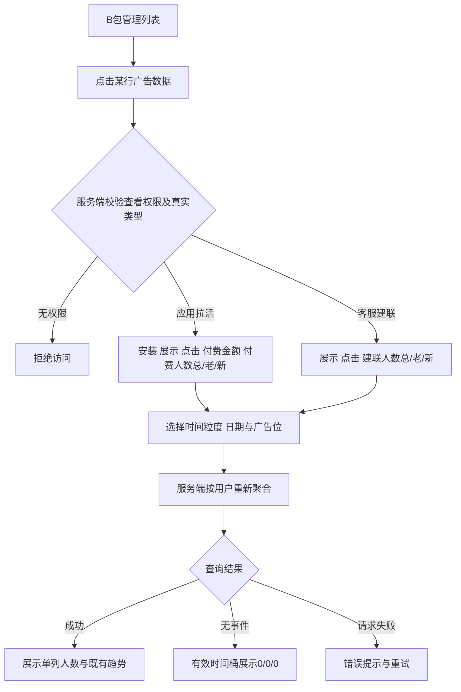

# B 包广告数据：付费与建联人数新老统计

版本：V1.1 · 日期：2026-11-13 · 交付对象：前端、后端、测试

状态：业务规则已由用户确认；本文补充实现约束、验收标准与待开发核验的数据映射。仅交付需求与本地原型，未实施业务代码或生产配置变更。

【本次更新】V1.1：原型视觉改为贴近生产后台的深色风格，沿用现有页面、侧栏、卡片、边框与蓝色主色；广告数据按960px圆角弹窗展示。演示工具移到底部，规则标注可展开／收起。统计口径与人数计算保持不变。

## 1. 目标与范围

面向具备 B 包数据查看权限的运营及投放人员，在现有「B 包管理 → 广告数据」详情中，区分首次付费／首次建联用户与回访用户，以判断拉活付费和客服建联效果。

| 类型 | 本次调整 | 显示要求 |
|---|---|---|
| 应用拉活（b） | 不显示建联；新增付费人数，保留原付费金额 | 列名「付费人数（总/老/新）」；一格显示 `10/5/5` |
| 客服建联（cs） | 原建联列调整为建联人数 | 列名「建联人数（总/老/新）」；一格显示 `10/5/5` |

明确：不是三列，不是三个可切换标签，不是付费次数，也不是付费金额拆分。数值顺序始终为「总/老/新」。

范围限定为 B 包广告数据详情。B 包主列表、白包 APP 列表与详情、全局数据概览、SDK 配置、素材竞价、频次、归因与 Adjust 回传规则不在本次变更范围。共享组件须按入口隔离，避免连带改变其他页面。

## 2. 已确认业务规则

| 编号 | 规则 |
|---|---|
| R01 | 应用拉活新增付费人数（总/老/新），保留原付费金额，不显示建联 |
| R02 | 客服建联的建联数据以一列展示总/老/新 |
| R03 | 新老付费按该用户在当前 B 包的首次有效付费时间判断，不按安装时间 |
| R04 | 新老建联按该用户在当前 B 包的首次有效建联时间判断，不按安装时间 |
| R05 | 各 B 包独立判断新老；用户在 A 包发生过行为，不影响其在 B 包的首次判定 |
| R06 | 付费和建联均统计去重人数；同一用户、同一 B 包、同一统计周期多次发生相同行为，只计 1 人 |
| R07 | 每行总人数 = 老人数 + 新人数；同一行新老互斥 |

例：用户昨日在 A 包付费，今日首次在 B 包付费，在 B 包今日报表记 1 名新付费用户。用户今日在 B 包首次建联后又建联两次，今日报表仍为 `1/0/1`。

## 3. 页面与用户流程

产品形态：现有桌面 Web 后台。页面复杂度：复杂页面（共享组件、多入口权限、时间聚合与广告位组合去重）。



### 3.1 页面结构与线框

```text
数据详情 - 当前B包                                      [关闭]
事件关联B包：当前B包              投放类型：应用拉活 / 客服建联
关联展示广告位：[开屏] [横幅] [插屏] [激励视频]（多选）
[时][日][周][月]  [开始日期] 至 [结束日期] [更新]
平台时间：印度时间 UTC+5:30
应用拉活：
日期 | 广告位 | 安装 | 展示 | 点击 | 付费金额 | 付费人数（总/老/新）
11-13| 全部   |  20  | 1500 | 120  | $126.00  | 10/5/5
客服建联：
日期 | 广告位 | 展示 | 点击 | 建联人数（总/老/新）
11-13| 全部   | 1500 | 120  | 10/5/5
人数说明：当前B包内去重；首次行为按每行统计周期判断。
趋势曲线（沿用既有指标；客服建联曲线取去重总人数）
```

### 3.2 P0 功能清单

- 🔴 F01：按投放类型显示正确的单列人数，金额与人数独立。
- 🔴 F02：当前 B 包内首次时间与每周期去重聚合。
- 🔴 F03：日期、时／日／周／月、广告位筛选与权限隔离。
- 🔴 F04：零值、失败、无权限、未就绪等状态处理与回归验收。

## 4. 统计口径与算法

### 4.1 人数集合

对当前 B 包 P、行为类型 E（付费或建联），使用稳定用户标识 U。首次时间 `first(P,U,E)` 为该用户在 P 内全部有效历史行为的最早统计时间。

对某一行实际覆盖的时间区间 `[s,e)`、所选广告位集合 A：

1. 取 P 内时间落在 `[s,e)` 且广告位属于 A 的有效 E 事件。
2. 按 U 去重得到集合 S。
3. 总 = `|S|`。
4. 新 = S 中满足 `s <= first(P,U,E) < e` 的人数。
5. 老 = S 中满足 `first(P,U,E) < s` 的人数。
6. 返回三项独立数值；前端仅拼接为「总/老/新」。

首次时间不得只查当前日期范围，也不得随广告位筛选重算。用户之前通过开屏首次付费，今日通过激励再次付费，只选激励时仍算老付费用户。同一用户同一行跨多个广告位只计 1 人，不得把各广告位 UV 相加。

付费人数只取现有规则认定为有效的付费事件；不得把展示、点击、安装、失败／未归因／尚待匹配回调当作付费人数。有效事件入库后计数不以 Adjust S2S 是否成功为前提。金额与原账务口径保持一致；金额与人数可因历史覆盖情况暂不可直接对账时，应在验收记录说明原因，不得凑数。

### 4.2 时间口径（实施约束）

- 沿用页面已标注的平台时区：印度时间 `Asia/Kolkata`（UTC+5:30）。不能使用浏览器本地时区或服务器默认时区隐式分桶。
- 日期输入首尾均包含；服务端转换为开始日 00:00:00 至结束日次日 00:00:00 的左闭右开区间。
- 日为自然日；周为周一 00:00 至下周一；月为自然月；小时为日期加小时。行的实际范围为自然桶与查询区间的交集。
- **跨日小时不能把不同日期的 09:00 合并成同一行**；标签必须带日期，如 `11-12 09:00`。跨年标签带年，排序使用完整时间而非展示字符串。
- 本需求“首次时间”与“本周期发生时间”必须使用同一种时间字段。为不迁移历史报表口径，V1 沿用现有报表统计时间（本地代码建联用 `create_time`）；付费以当前金额聚合使用的统计时间源为准。不要只对新人数改用回调发生时间而使同一事件进入不同周期。
- 若开发要改成付费 `event_timestamp`／建联 `connect_time`，须作为另一个口径迁移方案确认并同步历史，不能在本需求中静默切换。
- 当前尚未结束的桶展示截至查询时刻已入库数据，不预测未来；未来桶不得伪造事件。

### 4.3 去重与粒度

- 同一天首次付费后再次付费：日行只计 1 名新付费；次日再次付费：次日日行计 1 名老付费。
- 同周先新后老的同一用户，在周行只计 1 名新用户；同月同理。**周／月必须重新按集合去重，不能相加日人数或日新老数。**
- V1 不增加区间汇总行。若将来增加，需对整个查询区间重新去重；不得对各行人数求和。
- 事件重试、重复回调、同一用户多个 click_id、多个广告位，都不得重复增加人数。事件幂等与人数去重为两层逻辑。
- 并发请求须返回同一数据快照上的总／老／新；异步聚合必须同步更新三项，不能出现临时不相等。

### 4.4 用户与 B 包映射（开发核验项）

业务已确认“按用户去重、B 包独立”。底层技术字段须在联调前核验，不代表要求业务再选一次口径。

| 对象 | 本地代码可见字段 | V1 推荐映射与限制 |
|---|---|---|
| B 包 | `campaign_id` → `b_package.id`；事件含 `b_package_id` | 以稳定投放主键隔离，不以展示名称／投放标识分组；同名和同标识不合并 |
| 付费用户 | `mmp_revenue_log.gaid` | 沿用现有有效付费用户标识 gaid；为空不得把全部空值当一人，也不得按事件 ID 当不同人 |
| 建联用户 | `cs_connect_log.telegram_user_id`、gaid | 推荐稳定 Telegram 用户 ID；用户名可变，不能作为去重键；click_id 仅用于事件幂等 |
| 付费归属 | 日志含 B 包 `package`、`a_package`，未见直接 `b_package_id` | 开发核实 package → campaign_id 的唯一关系；存在同包名多投放时，必须使用可验证的事件归属映射，不得一条付费计入多个 B 包 |
| 建联时间 | `create_time`、`connect_time` 同时存在 | 本版沿用现有报表 `create_time`，首次时间同源 |

身份字段缺失的历史记录先列为数据质量缺口，不伪造“精确人数”。开发需提供覆盖量、处理方案与可追溯依据后再验收。若既有系统另有可靠统一用户 ID，可替代推荐映射，但须证明满足跨事件稳定性，且不改变已确认业务规则。

## 5. 交互与显示规则

### 5.1 F01 单列人数

- 从 B 包行点击「广告数据」，读取该记录真实投放类型；服务端决定可返回的指标，不信任客户端伪造类型。
- 应用拉活列顺序：日期、广告位、安装、展示、点击、原付费金额、付费人数（总/老/新）。原金额可以沿用现网列名「付费」，原型使用「付费金额」便于区分。
- 客服建联列顺序：日期、广告位、展示、点击、建联人数（总/老/新）；不增加付费人数或安装列。
- 人数为非负整数，无货币符号、无小数，固定总/老/新顺序。示例 `10/5/5`；大数分别加千分位，如 `12,000/7,000/5,000`。
- 数值在一个单元格内保持不换行，列宽建议不少于 210px；空间不足使用表格横向滚动，不能截断一半或拆成三列。
- 表头或数值提示：「按当前 B 包内用户去重；顺序为总人数/老人数/新人数。新老以每行统计周期及该 B 包首次行为时间判断。」
- 有效查询无行为展示 `0/0/0`；数据不可用展示 `—` 并提示原因，不能缺字段就当零。

### 5.2 F02/F03 查询与趋势

- 沿用现有广告位多选、时／日／周／月、日期和「更新」入口。广告位至少保留一项；本版沿用取消全部后恢复全部的现有规则。
- 粒度和广告位改变后自动查询，日期修改后点击更新生效；请求期间显示加载状态，避免重复更新。
- 日期必填、开始不得晚于结束；错误在页面内提示，不发出无效请求。不自行增加业务日期范围限制，沿用服务端已有能力。
- 最新请求生效；快速切换 B 包／粒度／广告位时，旧响应不得覆盖新筛选结果。切换投放时清除上一个投放人数，不能先显示旧数据。
- 保留现有趋势区域与既有指标开关；付费人数本次只新增表格列，不额外增加总／老／新三条曲线。客服原「建联」曲线使用去重总人数，并标识「建联人数」，与同一行总数一致。
- 此处客服趋势口径变更只作用于 B 包详情，不连带修改全局概览、白包详情或其他漏斗。
- 无编辑、保存、配置提交动作；关闭详情回到原列表并保留原筛选。

### 5.3 F04 状态清单

| 状态 | 页面表现 | 行为 |
|---|---|---|
| 默认／成功 | 正确类型的列、当前筛选、结果、人数说明 | 可查询、关闭、切换既有趋势指标 |
| 加载中 | 表格与趋势显示加载提示，隐藏旧投放数据 | 更新按钮禁用；关闭可用 |
| 零事件 | 时间桶保留，人数 `0/0/0` | 可调整时间或广告位 |
| 无可展示范围 | 「当前条件下暂无可展示数据」 | 可修改条件；不伪造合计 |
| 请求失败 | 「数据加载失败，请重试」 | 提供重试，筛选条件保留；不把失败显示为零 |
| 无权限 | 「无权查看该投放数据」 | 后端拒绝，前端不显示缓存内容；可关闭 |
| 数据未就绪 | 人数 `—`；「人数数据尚未就绪」 | 可重试；金额仍独立按既有接口展示 |
| 参数错误 | 「请选择完整日期范围」或「开始日期不能晚于结束日期」 | 阻止查询 |
| 记录不存在／已移除 | 「该投放不存在或已不可查看」 | 关闭返回列表；不自动落到其他 B 包 |

## 6. 建议接口契约（供开发对接）

现有前端使用 `GET /dashboard/trend`（路由相对后台 API 前缀），返回 `labels` 与 `series`。以下为增量设计建议，不宣称现网已有这些字段；开发可按现有 DTO 规范落地，但语义不得改变。

### 6.1 请求

| 字段 | 类型／要求 | 规则 |
|---|---|---|
| campaign_id | 正整数，B 包入口必填 | 对应当前 B 包主键；服务端校验授权和类型 |
| campaign_type | b / cs，可兼容传递 | 仅提示；与服务端真实记录冲突时拒绝或以真实类型为准，不可越权 |
| start_date / end_date | YYYY-MM-DD，必填 | 平台时区日期；首尾均包含 |
| type | hour/day/week/month | 默认与现有详情一致为 day |
| ad_type | 既有广告位枚举逗号列表，可省略 | 省略为全部；开屏 open、横幅 banner、插屏 interstitial、激励 rewarded |

### 6.2 响应字段

保留既有 `labels` 与 `series` 的旧字段与含义；人数新增一个独立结构，不把 `10/5/5` 当作计算字段返回，不覆盖旧 `connect` 的全局接口语义。

```json
{
  "labels": ["2026-11-13"],
  "series": [],
  "person_stats": {
    "metric": "pay_users",
    "status": "ready",
    "timezone": "Asia/Kolkata",
    "rows": [
      {
        "start_at": "2026-11-13T00:00:00+05:30",
        "end_at": "2026-11-14T00:00:00+05:30",
        "total": 10,
        "old": 5,
        "new": 5
      }
    ]
  }
}
```

例中 `series: []` 为省略展示，实际成功响应须保留既有安装／展示／点击／金额系列。客服 `metric=connect_users`；不适用指标省略，不返回误导性零值。rows 与 labels 一一对应，使用 start_at/end_at 作稳定键，不以短标签关联。`status=ready` 时 total/old/new 全部必填、非负整数且总=老+新；`status=unavailable` 时不提供虚构数值，前端显示 `—`。服务端查询错误必须报错，不能静默吞掉后返回 ready+零值。

若现有封装字段命名不同，以工程规范调整；本契约语义与本文验收用例为准。人数超过 JavaScript 安全整数范围时使用十进制字符串并保持整数展示，禁止浮点截断。

## 7. 后端实现建议与工程核验

### 7.1 现状依据（本地源码，非生产数据库审计）

| 位置 | 可见现状 | 本次关注 |
|---|---|---|
| admin-web/src/components/DataDetailModal.vue | 共享表格／趋势、按 campaignType 过滤指标；应用拉活已隐藏建联 | 增加专用人数单元格；按 B 包入口隔离 |
| web/admin/dashboard.go、trend.go | 趋势接口组合多个来源，series 动态生成 | 新增人数结构及真实类型校验；错误不可忽略 |
| pkg/dao/ad/report_trend.go | 建联趋势 `COUNT(*)`，筛选广告位通过 cs_click 关联 | 记录数改为本详情专用用户集合；不全局替换原接口 |
| pkg/entity/mmp_revenue_log.go | 付费明细有 gaid、package、事件时间、落库时间 | UV 从明细或等价去重事实生成，不能从金额倒推 |
| pkg/entity/cs_connect.go | 建联日志有 Telegram ID、gaid、B包ID、click_id | click_id 去重不等于用户去重 |
| pkg/dao/ad/report_trend.go、web/admin/dashboard.go | 小时标签可能只保留 HH:00 | 本详情跨日小时需完整桶键，不能跨天合并 |

### 7.2 实施顺序

1. 核验用户标识、事件到 B 包唯一映射、现有统计时间、历史保留周期；形成联调记录。
2. 以 `(B包ID, 用户标识, 行为类型)` 维护或查询历史首次时间；采用可重复执行、最小时间更新，防并发和乱序。
3. 对实际周期、当前广告位事件构建用户集合，首次时间查询不带日期和广告位过滤；使用服务端聚合，避免每行单独查询。
4. 实现增量接口和详情单元格；客服趋势总人数与表格同源。
5. 在测试环境执行验收；评估去重查询计划和索引后再发布。不得在本次文档交付中执行生产迁移。

### 7.3 历史与一致性

- 新老依赖查询范围之前的历史，禁止上线当天把所有活跃用户都标成新。
- 可读取完整有效历史则重建首次时间及人数；若已裁剪历史，先核验是否存在可信首次事实表。两者都无时不能声称精确新老，须显示未就绪并在发布前明确可准确覆盖的日期范围。
- 回填／重算不得改变旧金额、安装、广告展示点击、首归因白包或 Adjust 去重逻辑。
- 迟到有效事件入库后，相关人数和首次事实要可重算；首次时间取最小值，重复导入不累加人数。
- 权限沿用现有 `package:detail` 与投放授权范围；服务端对新增人数同样鉴权。缓存键包含授权范围、B包ID、日期、粒度、广告位；不可跨账号缓存泄漏。
- 新增接口不得返回用户标识、Telegram ID、回调 token 等明细给页面。日志记录错误和必要统计诊断，不包含账户密码。
- 性能目标沿用现有后台 SLA；[待开发核验] 生产数据量、可查跨度、响应基线与索引方案，发布前用实际规模验证，不编造已达标指标。

## 8. 验收用例

下表两种行为均测试；时间均为印度时间。除明确说明外，当前 B 包独立、无广告位过滤、按日查询。

| ID | 输入场景 | 预期 |
|---|---|---|
| T01 | 应用拉活打开详情 | 无建联列；金额保留；一列付费人数（总/老/新） |
| T02 | 客服建联打开详情 | 展示、点击、单列建联人数；无付费人数和付费金额 |
| T03 | 当天5名历史用户再次行为、5名用户首次行为 | 单元格 `10/5/5`，不拆三列 |
| T04 | 当天同一新用户行为3次 | `1/0/1`；不同时算老 |
| T05 | 当天同一老用户行为3次 | `1/1/0` |
| T06 | 昨天B包A行为，今天首次B包B行为 | B今天 `1/0/1`；A不改变B首次判定 |
| T07 | 昨日首次、今日再次，查询日期只选今日 | 今日 `1/1/0`；不得从查询开始重新算首个 |
| T08 | 周一首次、周二再次；分别按日及整周查询 | 周一新1、周二老1；周行 `1/0/1`，非 `2/1/1` |
| T09 | 上月首次，本月重复行为 | 本月 `1/1/0`；月内重复去重 |
| T10 | 昨日开屏首次，今日激励再次，只选激励 | 今日 `1/1/0`，首次不随广告位筛选改变 |
| T11 | 同一用户在本周期多个广告位发生行为 | 多选广告位合并后总人数仍为1 |
| T12 | 有效时间桶无事件 | `0/0/0`；无货币、小数、null |
| T13 | 请求失败、字段缺失或历史首次不可还原 | 错误或 `—`，不得伪装 `0/0/0` |
| T14 | 不同日期同为09点有事件 | 小时分两行，日期完整；不合并 |
| T15 | 23:59:59与次日00:00:00两个事件 | 分入相应日；边界事件不重复计入 |
| T16 | 同一小时首次后下一小时再次 | 第一小时新1，第二小时老1；当日总去重仍为1 |
| T17 | 权限不足／伪造campaign_id、campaign_type | 后端拒绝；不显示旧缓存或他人投放 |
| T18 | 快速切换条件，旧请求最后返回 | 仅最新条件结果展示 |
| T19 | 缺失用户ID、无法唯一映射B包的历史 | 报出数据质量缺口，不能空值合为1或重复归属 |
| T20 | 重试回调、重复回填、乱序入库 | 总数不膨胀；首次取最小可用统计时间；总=老+新 |
| T21 | 客服详情趋势悬浮同一行 | 建联人数曲线值等于该行总人数 |
| T22 | 同一B包改显示名／投放标识 | 首次历史不重置；不同ID不合并 |
| T23 | 回归白包详情、全局概览、B包主列表 | 既有列和原接口语义不受本详情扩展影响 |
| T24 | 无效日期、未选日期、无广告位 | 日期阻止查询；广告位全取消恢复全部 |

## 9. 原型与交接说明

- `index.html`：贴近生产后台风格的本地交互原型，含两种 B 包与一个跨包示例，模拟事件账本、时间粒度、广告位、零值、错误、未就绪、无权限、模拟事件明细和规则说明。
- `需求文档.html`：适合浏览与打印的本文版本；`需求文档.md` 为可编辑源。
- 原型为模拟数据，无生产请求、无凭证、无配置保存功能。B包切换和状态选择为原型演示工具，不要求在正式后台新增这套控制栏。
- 原型默认展示人数列、关联信息、筛选、表格、既有趋势；不代表改动后台整体视觉。趋势仅展示选定的一个既有指标以便观察，正式页面保留原有多指标开关。
- 正式上线前必须完成第4.4节字段核验及第7.3节历史覆盖核验；这两项是工程数据核验，不是已经完成的生产结论。

## 10. 交付完成标准

业务规则 R01—R07、单列显示、广告位合并去重和跨粒度重算全部通过；接口鉴权和异常状态可复测；历史首次覆盖范围有记录；金额与原归因回归通过。交接文件与原型本地打开可用，生产配置保持原状。
